<div align="center">

<picture>
  <source media="(prefers-color-scheme: dark)" srcset="assets/img/banner-dark.png">
  
</picture>

<br>

**Ein geführter Ablauf für Claude-Projekte. Du bringst die Idee mit, Claude führt dich in elf Phasen bis zur fertigen App.**

<br>


[Worum es geht](#worum-es-geht) · [Ablauf](#der-weg-in-elf-phasen) · [Start](#in-vier-schritten-startklar) · [Führung](#so-führt-dich-claude) · [Phasen](#alle-phasen-im-detail) · [Ergebnis](#was-am-ende-entsteht) · [Lehre](#für-dozentinnen-und-dozenten)

</div>

<br>

<a id="worum-es-geht"></a>
<picture>
  <source media="(prefers-color-scheme: dark)" srcset="assets/img/h-worum-dark.png">
  
</picture>

Du hast eine Idee für eine App, kannst aber nicht programmieren. Dieses Repository enthält alles, um die Idee mit KI umzusetzen: eine Projektanweisung und elf Phasen-Prompts für ein **Claude-Projekt**.

| Was du bekommst | Was das für dich heißt |
|---|---|
| **Einen Wizard** | Claude stellt die Fragen, du wählst aus. Du musst nicht wissen, was als Nächstes kommt. |
| **Einen roten Faden** | Jede Phase liefert eine Übergabe, die die nächste Phase liest. Nichts geht verloren. |
| **Echte Ergebnisse** | Steckbrief, Wireframes, Design, eine laufende App in Lovable, ein Pitch Deck, ein GitHub-Repo. |
| **Deine eigene Idee** | Du baust etwas, das dir wichtig ist: deine Daten, deine Abläufe, deine Website. |

> [!TIP]
> Am meisten lernst du mit einer Idee, die du selbst nutzen willst. Du darfst die wichtigste Nutzerin oder der wichtigste Nutzer deiner App sein.

<br>

<a id="der-weg-in-elf-phasen"></a>
<picture>
  <source media="(prefers-color-scheme: dark)" srcset="assets/img/h-ablauf-dark.png">
  
</picture>

Fünf Werkzeuge, ein Ablauf. Claude plant mit dir, ein Design-Werkzeug gestaltet, Lovable baut, GitHub sichert.

<picture>
  <source media="(prefers-color-scheme: dark)" srcset="assets/img/werkzeuge-dark.png">
  
</picture>

<br>

<picture>
  <source media="(prefers-color-scheme: dark)" srcset="assets/img/phasen-dark.png">
  
</picture>

> [!NOTE]
> **Phase 1 bis 6** bauen aufeinander auf. **Phase 7, 8, 10 und 11** sind optional. **Phase 9** startest du jederzeit nach Phase 5.

<br>

<a id="in-vier-schritten-startklar"></a>
<picture>
  <source media="(prefers-color-scheme: dark)" srcset="assets/img/h-start-dark.png">
  
</picture>

Du brauchst ein Konto bei [claude.ai](https://claude.ai) und später eins bei [lovable.dev](https://lovable.dev).

### 1 · Dateien herunterladen

Oben auf **Code → Download ZIP** klicken und die ZIP-Datei entpacken. Du brauchst den Ordner [`projekt-dateien`](projekt-dateien).

### 2 · Claude-Projekt anlegen und Anweisung einfügen

In Claude links auf **Projekte**, dann auf **Neues Projekt**. Es öffnet sich das Fenster „Projekt erstellen“:

| Feld | Was du einträgst |
|---|---|
| **Woran arbeitest du?** | Ein Name für dein Projekt, zum Beispiel der deiner App |
| **Was möchtest du erreichen?** | Den kompletten Text aus [`00 - Projektanweisung (System-Prompt).md`](projekt-dateien/00%20-%20Projektanweisung%20%28System-Prompt%29.md) |

Dann auf **Projekt erstellen** klicken.


So sieht das Projekt danach aus. Oben steht der Anfang deiner Anweisung:


> [!NOTE]
> Hast du das Feld leer gelassen? Dann trägst du den Text rechts unter **Anweisungen** → **Hinzufügen** nach.

### 3 · Dateien hochladen

Rechts bei **Kontext** auf **Hinzufügen** und **Vom Gerät hochladen**. Lade alle Dateien aus `projekt-dateien` hoch, außer der Projektanweisung. Am Ende stehen dort 15 Dateien.

<table>
<tr>
<td width="50%"></td>
<td width="50%"></td>
</tr>
</table>

### 4 · Ersten Chat starten

Neuen Chat im Projekt öffnen und den Startsatz senden:

```
Phase 1: Idee finden
```

> [!IMPORTANT]
> **Jede Phase bekommt einen eigenen Chat.** Am Ende jeder Phase nennt dir Claude den Startsatz der nächsten. Der Startsatz wird zum Titel des Chats, so findest du jede Phase wieder.

<br>

<a id="so-führt-dich-claude"></a>
<picture>
  <source media="(prefers-color-scheme: dark)" srcset="assets/img/h-fuehrung-dark.png">
  
</picture>

Jede Antwort hat denselben Aufbau. Du liest oben, wo du bist, und unten, was du tun kannst.

<picture>
  <source media="(prefers-color-scheme: dark)" srcset="assets/img/antwort-dark.png">
  
</picture>

**Kurzbefehle, die du jederzeit schreiben kannst**

| Befehl | Was passiert |
|---|---|
| `weiter` | Claude übernimmt alle Empfehlungen und geht zum nächsten Schritt |
| `zurück` | Ein Schritt zurück |
| `Hilfe` | Claude erklärt den Schritt mit einem Beispiel |
| `Stand` | Zwischenstand des Ergebnisses anzeigen |

Einzelne Phasen haben zusätzliche Befehle, zum Beispiel `neu` und `fertig` beim Iterieren.

<br>

<a id="alle-phasen-im-detail"></a>
<picture>
  <source media="(prefers-color-scheme: dark)" srcset="assets/img/h-phasen-dark.png">
  
</picture>

Jede Karte führt zu einer eigenen Seite mit Ziel, Schritten, Ergebnissen und deinem Teil.

<table>
<tr>
<td width="33%"><a href="docs/phasen/01-idee-finden.md"><picture><source media="(prefers-color-scheme: dark)" srcset="assets/img/card-01-dark.png">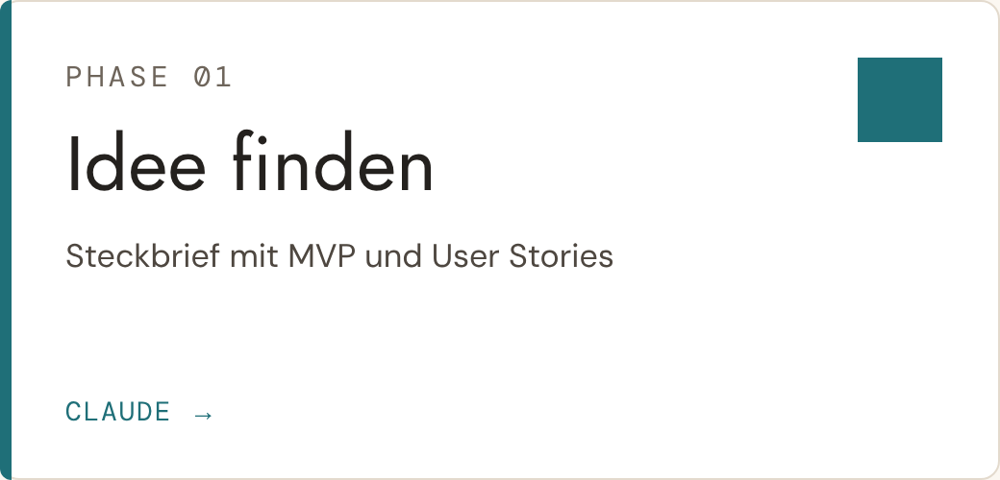</picture></a></td>
<td width="33%"><a href="docs/phasen/02-wireframes.md"><picture><source media="(prefers-color-scheme: dark)" srcset="assets/img/card-02-dark.png">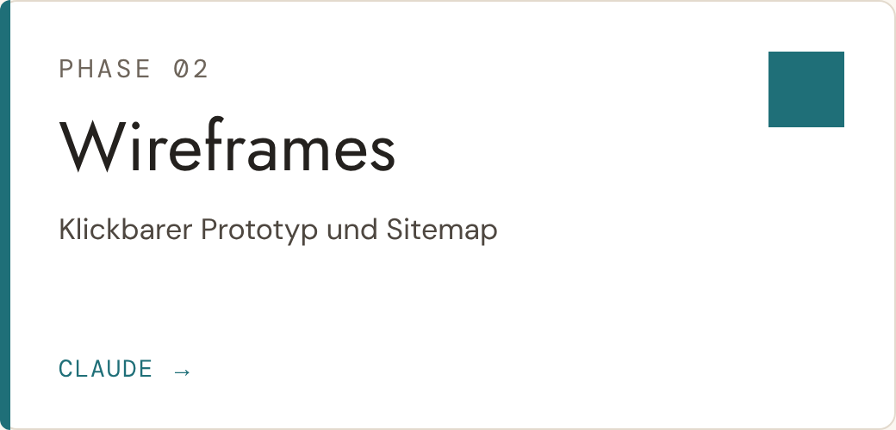</picture></a></td>
<td width="33%"><a href="docs/phasen/03-style-guide.md"><picture><source media="(prefers-color-scheme: dark)" srcset="assets/img/card-03-dark.png">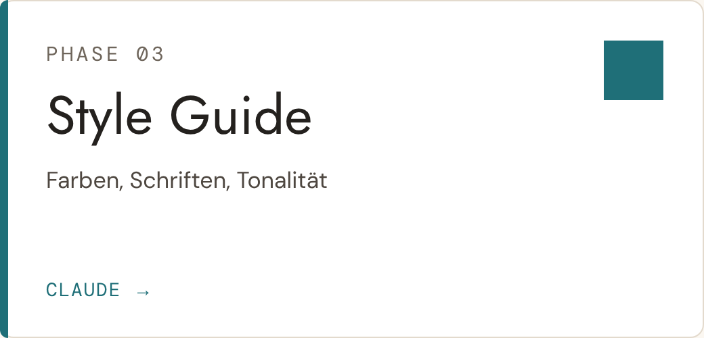</picture></a></td>
</tr>
<tr>
<td width="33%"><a href="docs/phasen/04-design.md"><picture><source media="(prefers-color-scheme: dark)" srcset="assets/img/card-04-dark.png">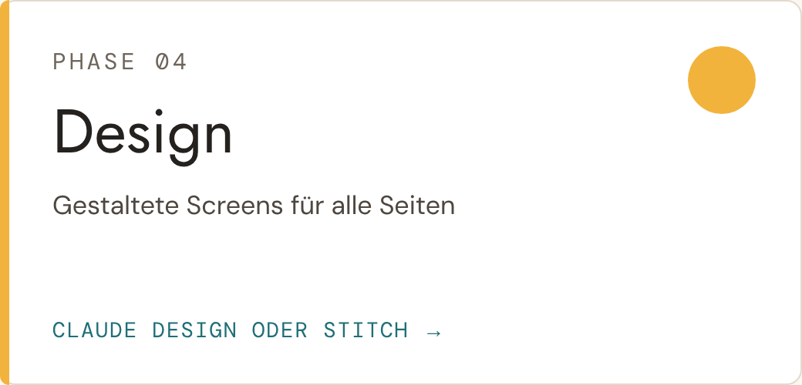</picture></a></td>
<td width="33%"><a href="docs/phasen/05-start-in-lovable.md"><picture><source media="(prefers-color-scheme: dark)" srcset="assets/img/card-05-dark.png">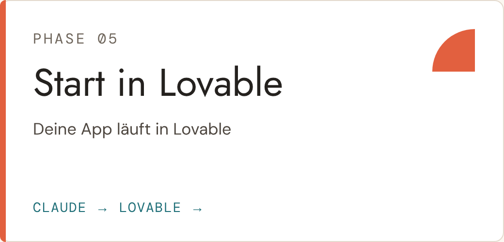</picture></a></td>
<td width="33%"><a href="docs/phasen/06-iterieren.md"><picture><source media="(prefers-color-scheme: dark)" srcset="assets/img/card-06-dark.png">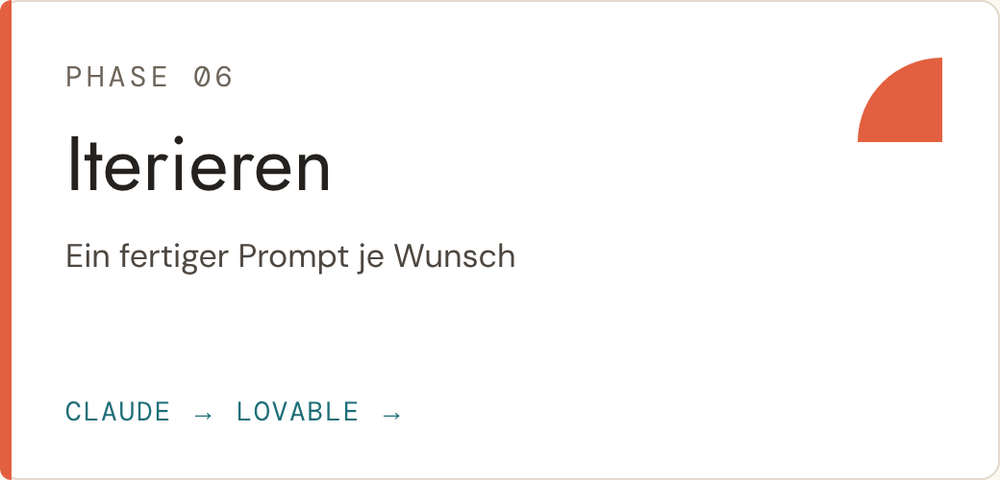</picture></a></td>
</tr>
<tr>
<td width="33%"><a href="docs/phasen/07-datenbank.md"><picture><source media="(prefers-color-scheme: dark)" srcset="assets/img/card-07-dark.png">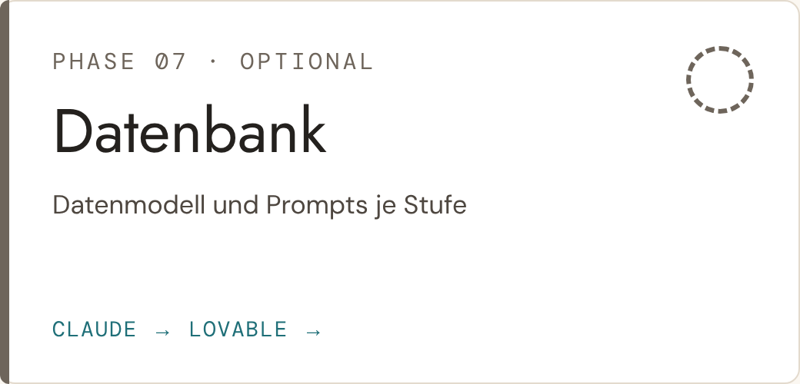</picture></a></td>
<td width="33%"><a href="docs/phasen/08-ki-funktion.md"><picture><source media="(prefers-color-scheme: dark)" srcset="assets/img/card-08-dark.png">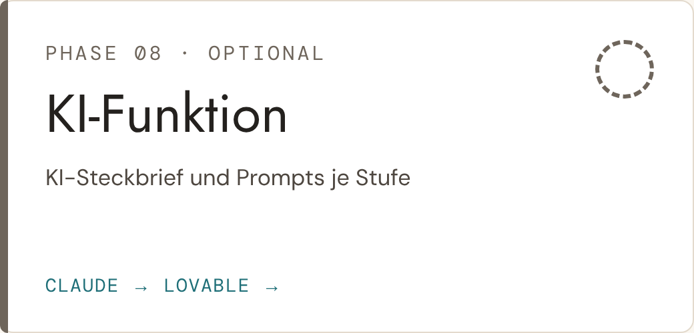</picture></a></td>
<td width="33%"><a href="docs/phasen/09-pitch-deck.md"><picture><source media="(prefers-color-scheme: dark)" srcset="assets/img/card-09-dark.png">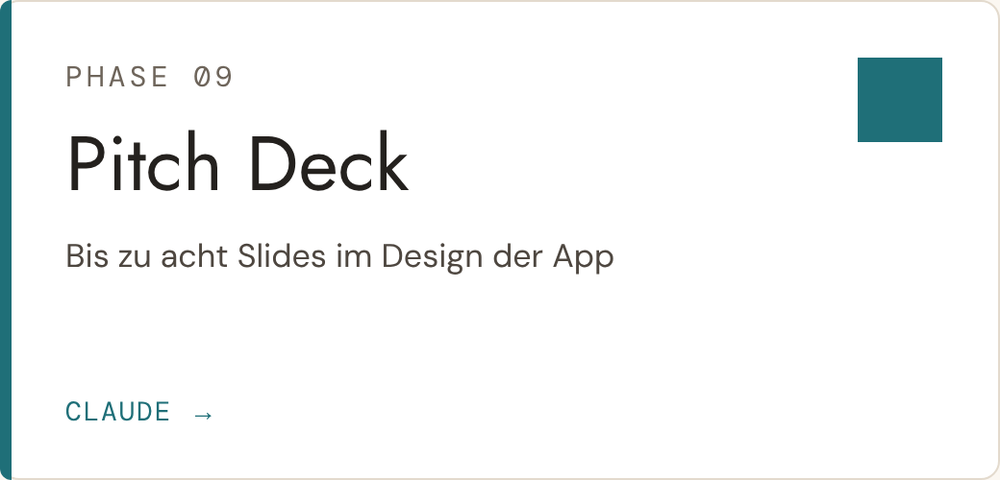</picture></a></td>
</tr>
<tr>
<td width="33%"><a href="docs/phasen/10-code-auf-github.md"><picture><source media="(prefers-color-scheme: dark)" srcset="assets/img/card-10-dark.png">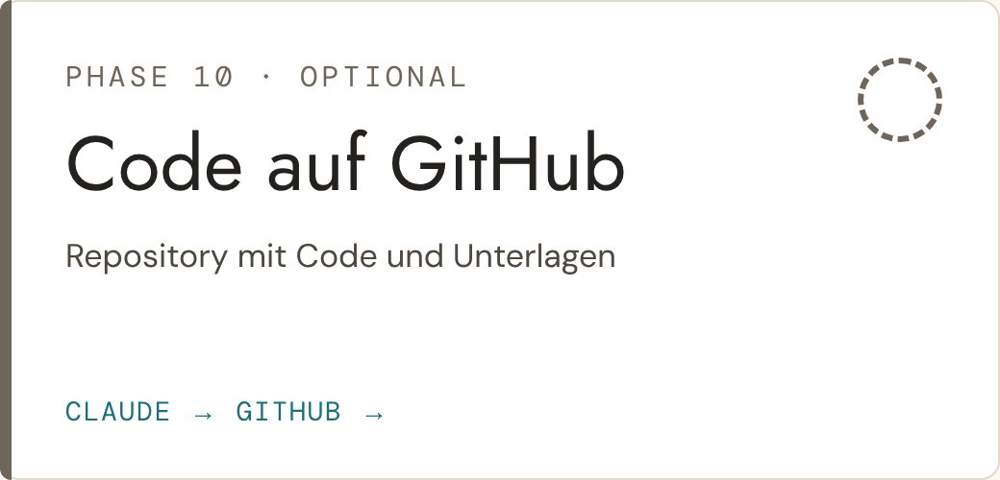</picture></a></td>
<td width="33%"><a href="docs/phasen/11-github-auftritt.md"><picture><source media="(prefers-color-scheme: dark)" srcset="assets/img/card-11-dark.png">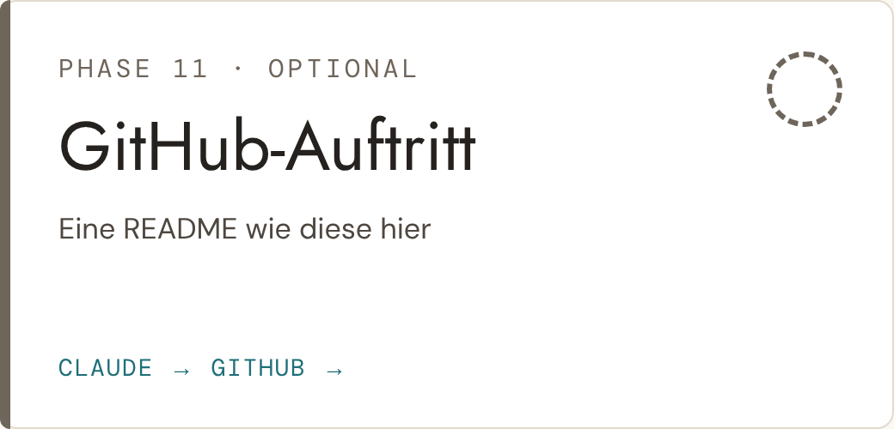</picture></a></td>
</tr>
</table>

<details>
<summary><b>Alle Startsätze auf einen Blick</b></summary>

<br>

| # | Phase | Startsatz | Ergebnis |
|---|---|---|---|
| `01` | [Idee finden](docs/phasen/01-idee-finden.md) | `Phase 1: Idee finden` | STECKBRIEF – [App-Name] |
| `02` | [Wireframes](docs/phasen/02-wireframes.md) | `Phase 2: Wireframes` | WIREFRAMES – [App-Name] |
| `03` | [Style Guide](docs/phasen/03-style-guide.md) | `Phase 3: Style Guide` | STYLE GUIDE – [App-Name] |
| `04` | [Design](docs/phasen/04-design.md) | `Phase 4: Design` | DESIGN – [App-Name] |
| `05` | [Start in Lovable](docs/phasen/05-start-in-lovable.md) | `Phase 5: Start in Lovable` | Start-Prompt |
| `06` | [Iterieren](docs/phasen/06-iterieren.md) | `Phase 6: Iterieren` | PROMPT – [Kurzname] |
| `07` | [Datenbank](docs/phasen/07-datenbank.md) | `Phase 7: Datenbank` | DATENMODELL – [App-Name] |
| `08` | [KI-Funktion](docs/phasen/08-ki-funktion.md) | `Phase 8: KI-Funktion` | KI-STECKBRIEF – [App-Name] |
| `09` | [Pitch Deck](docs/phasen/09-pitch-deck.md) | `Phase 9: Pitch Deck` | PITCH DECK – [App-Name] |
| `10` | [Code auf GitHub](docs/phasen/10-code-auf-github.md) | `Phase 10: Code auf GitHub` | GitHub-Repository |
| `11` | [GitHub-Auftritt](docs/phasen/11-github-auftritt.md) | `Phase 11: GitHub-Auftritt` | README.md |

</details>

<details>
<summary><b>Hilfen, jederzeit in einem eigenen Chat</b></summary>

<br>

| Datei | Startsatz | Wofür |
|---|---|---|
| [Hilfe - Design in Stitch iterieren](projekt-dateien/Hilfe%20-%20Design%20in%20Stitch%20iterieren.md) | `Design in Stitch iterieren` | Design in Stitch verbessern |
| [Hilfe - Design in Stitch starten](projekt-dateien/Hilfe%20-%20Design%20in%20Stitch%20starten.md) | wird von Phase 4 geladen | Startpaket für Google Stitch |
| [Hilfe - UI-Lexikon](projekt-dateien/Hilfe%20-%20UI-Lexikon.md) | `UI-Lexikon erstellen` | Bausteine einer Oberfläche nachschlagen |
| [Hilfe - UX-Leitfaden](projekt-dateien/Hilfe%20-%20UX-Leitfaden.md) | `UX-Leitfaden erstellen` | Regeln für gute Bedienbarkeit |

</details>

<details>
<summary><b>Welche Übergabe liest welche Phase?</b></summary>

<br>

```mermaid
flowchart LR
  P1[01 Idee] -->|STECKBRIEF| P2[02 Wireframes]
  P2 -->|ÜBERGABE WIREFRAMES| P3[03 Style Guide]
  P3 -->|STYLE GUIDE| P4[04 Design]
  P4 -->|Design-Dateien| P5[05 Lovable]
  P5 --> P6[06 Iterieren]
  P6 --> P7[07 Datenbank]
  P7 -->|DATENMODELL| P8[08 KI-Funktion]
  P8 -->|KI-STECKBRIEF| P9[09 Pitch Deck]
  P9 --> P10[10 GitHub]
  P10 --> P11[11 Auftritt]
  PB[(PROJEKTBUCH)] -.-> P1 & P5 & P9 & P11
  classDef claude fill:#1F6F78,color:#fff,stroke:#1F6F78
  classDef design fill:#F2B33D,color:#24211E,stroke:#F2B33D
  classDef lov fill:#E2603F,color:#fff,stroke:#E2603F
  classDef opt fill:#FBF7F1,color:#24211E,stroke:#6E655B,stroke-dasharray:4 3
  class P1,P2,P3,P9 claude
  class P4 design
  class P5,P6 lov
  class P7,P8,P10,P11 opt
```

Das **Projektbuch** begleitet alle Phasen. Es hält Entscheidungen, Stand und Prompt-Protokoll fest.

</details>

<br>

<a id="was-am-ende-entsteht"></a>
<picture>
  <source media="(prefers-color-scheme: dark)" srcset="assets/img/h-ergebnis-dark.png">
  
</picture>

Jede Phase liefert ein greifbares Ergebnis. Hier am Beispiel der erfundenen Haushaltsbuch-App **„Groschen“** mit der Persona Paula. Ein Klick öffnet die Phase.

<table>
<tr>
<td width="33%" valign="top"><a href="docs/phasen/01-idee-finden.md"><picture><source media="(prefers-color-scheme: dark)" srcset="assets/img/beispiel-01-dark.png">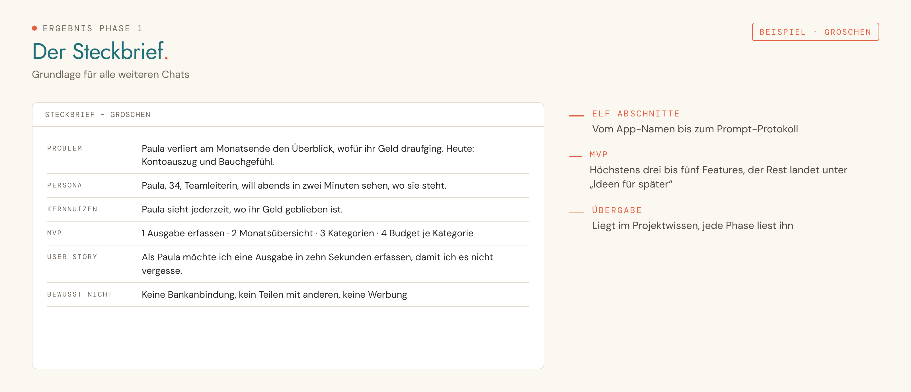</picture></a><br><sub><b>01 · Idee finden</b></sub></td>
<td width="33%" valign="top"><a href="docs/phasen/02-wireframes.md"><picture><source media="(prefers-color-scheme: dark)" srcset="assets/img/beispiel-02-dark.png">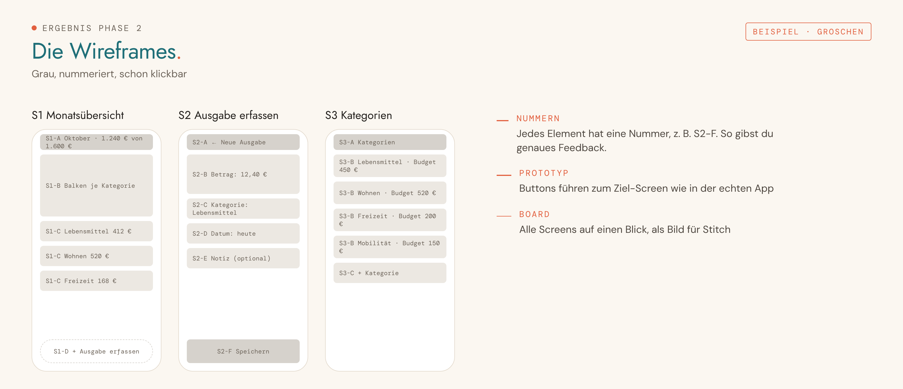</picture></a><br><sub><b>02 · Wireframes</b></sub></td>
<td width="33%" valign="top"><a href="docs/phasen/03-style-guide.md"><picture><source media="(prefers-color-scheme: dark)" srcset="assets/img/beispiel-03-dark.png">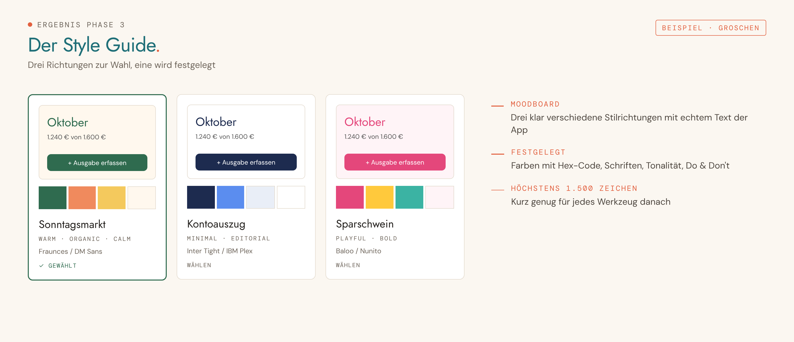</picture></a><br><sub><b>03 · Style Guide</b></sub></td>
</tr>
<tr>
<td width="33%" valign="top"><a href="docs/phasen/04-design.md"><picture><source media="(prefers-color-scheme: dark)" srcset="assets/img/beispiel-04-dark.png">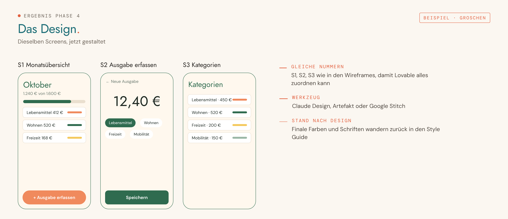</picture></a><br><sub><b>04 · Design</b></sub></td>
<td width="33%" valign="top"><a href="docs/phasen/05-start-in-lovable.md"><picture><source media="(prefers-color-scheme: dark)" srcset="assets/img/beispiel-05-dark.png">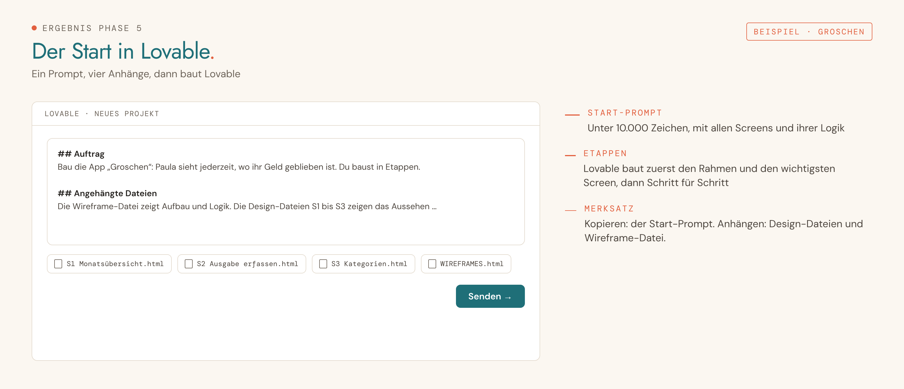</picture></a><br><sub><b>05 · Start in Lovable</b></sub></td>
<td width="33%" valign="top"><a href="docs/phasen/06-iterieren.md"><picture><source media="(prefers-color-scheme: dark)" srcset="assets/img/beispiel-06-dark.png">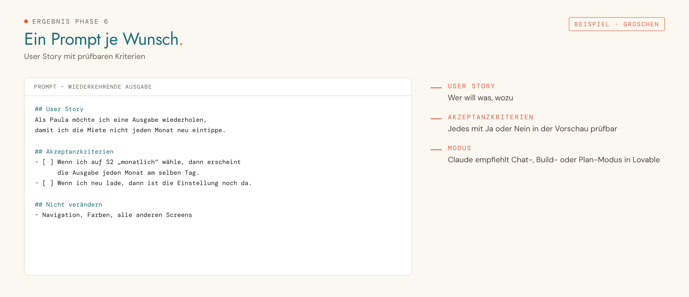</picture></a><br><sub><b>06 · Iterieren</b></sub></td>
</tr>
<tr>
<td width="33%" valign="top"><a href="docs/phasen/07-datenbank.md"><picture><source media="(prefers-color-scheme: dark)" srcset="assets/img/beispiel-07-dark.png">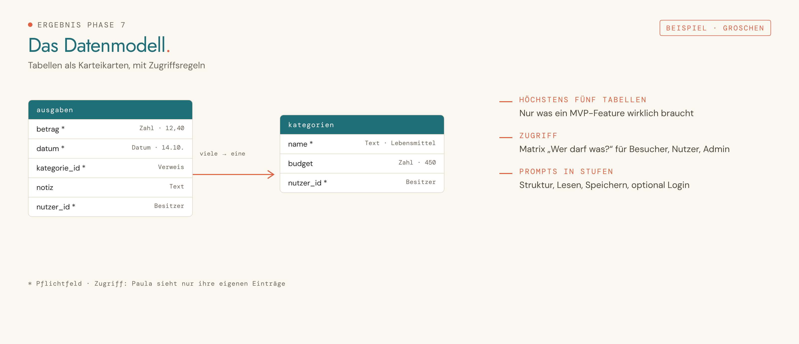</picture></a><br><sub><b>07 · Datenbank</b></sub></td>
<td width="33%" valign="top"><a href="docs/phasen/08-ki-funktion.md"><picture><source media="(prefers-color-scheme: dark)" srcset="assets/img/beispiel-08-dark.png">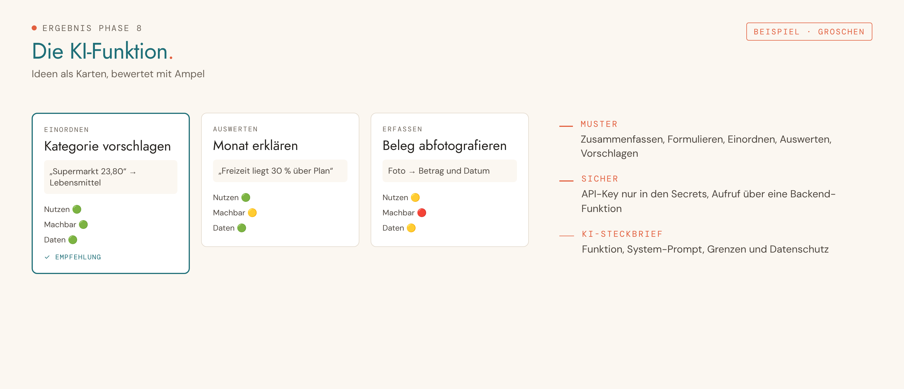</picture></a><br><sub><b>08 · KI-Funktion</b></sub></td>
<td width="33%" valign="top"><a href="docs/phasen/09-pitch-deck.md"><picture><source media="(prefers-color-scheme: dark)" srcset="assets/img/beispiel-09-dark.png">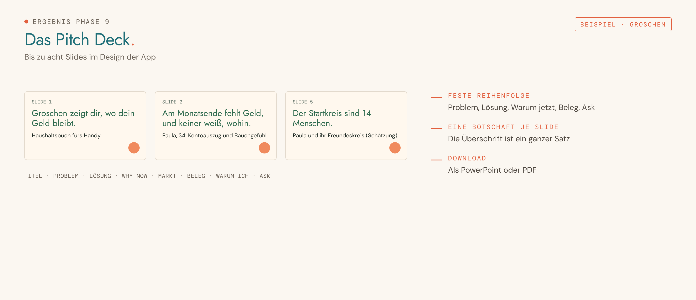</picture></a><br><sub><b>09 · Pitch Deck</b></sub></td>
</tr>
</table>

> [!NOTE]
> „Groschen“ ist ein ausgedachtes Beispiel. Deine eigene App sieht anders aus, der Ablauf ist derselbe.

Und so sieht ein echtes Repository nach Phase 10 aus, aus einem Testlauf mit der App „HappyHaus“:


<br>

<a id="für-dozentinnen-und-dozenten"></a>
<picture>
  <source media="(prefers-color-scheme: dark)" srcset="assets/img/h-dozent-dark.png">
  
</picture>

Der Ablauf ist für eine Schulungswoche gebaut und funktioniert genauso allein.

| Tag | Phasen | Werkzeug |
|---|---|---|
| 1 | 1 Idee, 2 Wireframes | Claude |
| 2 | 3 Style Guide, 4 Design | Claude, Claude Design oder Stitch |
| 3 | 5 Start in Lovable, 6 Iterieren | Lovable |
| 4 | 7 Datenbank, 8 KI-Funktion | Lovable, Supabase |
| 5 | 9 Pitch Deck, 10 und 11 GitHub | Claude, GitHub |

**Anpassen**

- **Werkzeuge vorgeben:** Phase 4 fragt neutral nach Claude Design oder Stitch. Ist Claude Design gesperrt, baut Claude das Design als Artefakt. Phase 10 fragt, ob Lovable mit GitHub verbunden werden darf.
- **API-Key für Phase 8:** Den Namen des Secrets und den Anbieter trägst du in `Phase 08 - KI-Funktion.md` ein, bisher steht dort `[SECRET_NAME]`.
- **Antwortformat:** Aufbau, Fragen und Kurzbefehle stehen einmal zentral in der Projektanweisung. Änderst du sie dort, gelten sie in allen Phasen.

> [!TIP]
> Spiel Phase 1 einmal selbst mit einer „herausfordernden“ Testperson durch: nur mit „weiß nicht“ und „ok“ antworten. Claude sollte den Chat trotzdem bis zum Steckbrief tragen.

<br>

## Dateien im Überblick

```
vibe-coding-wizard/
├── README.md
├── LICENSE
├── projekt-dateien/
│   ├── 00 - Projektanweisung (System-Prompt).md   → in die Anweisungen
│   ├── Phase 01 - Idee finden.md                  → in den Kontext
│   ├── …
│   ├── Phase 11 - GitHub-Auftritt.md
│   └── Hilfe - ….md                               → in den Kontext
├── docs/
│   └── phasen/     eine Seite je Phase: Ziel, Schritte, Ergebnis, dein Teil
└── assets/
    ├── img/        Grafiken dieser Seite
    └── screens/    Screenshots aus Claude und GitHub
```

<br>

---

<div align="center">

<sub>Entwickelt von <b>Sebastian Göhr</b> · <a href="https://pattern-shift.works">Pattern Shift</a> · gestaltet im Pattern-Shift-Design · MIT-Lizenz</sub>

</div>
