<div align="center">

<picture>
  <source media="(prefers-color-scheme: dark)" srcset="assets/img/banner-dark.png">
  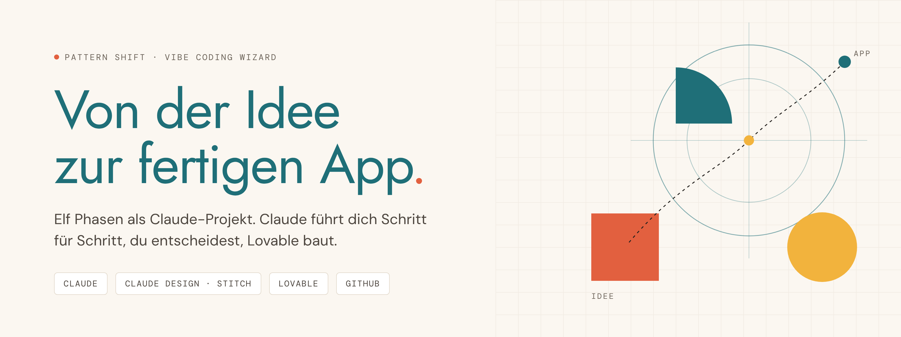
</picture>

<br>

**Ein geführter Ablauf für Claude-Projekte. Du bringst die Idee mit, Claude führt dich in elf Phasen bis zur fertigen App.**

<br>


[Worum es geht](#worum-es-geht) · [Ablauf](#der-weg-in-elf-phasen) · [Start](#in-vier-schritten-startklar) · [Führung](#so-führt-dich-claude) · [Phasen](#alle-phasen-im-detail) · [Ergebnis](#was-am-ende-entsteht) · [Lehre](#für-dozentinnen-und-dozenten)

</div>

<br>

<a id="worum-es-geht"></a>
<picture>
  <source media="(prefers-color-scheme: dark)" srcset="assets/img/h-worum-dark.png">
  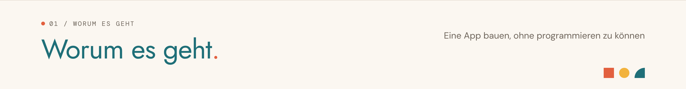
</picture>

Du hast eine Idee für eine App, kannst aber nicht programmieren. Dieses Repository enthält alles, um die Idee mit KI umzusetzen: eine Projektanweisung und elf Phasen-Prompts für ein **Claude-Projekt**.

| Was du bekommst | Was das für dich heißt |
|---|---|
| **Einen Wizard** | Claude stellt die Fragen, du wählst aus. Du musst nicht wissen, was als Nächstes kommt. |
| **Einen roten Faden** | Jede Phase liefert eine Übergabe, die die nächste Phase liest. Nichts geht verloren. |
| **Echte Ergebnisse** | Steckbrief, Wireframes, Design, eine laufende App in Lovable, ein Pitch Deck, ein GitHub-Repo. |
| **Deine eigene Idee** | Du baust etwas, das dir wichtig ist: deine Daten, deine Abläufe, deine Website. |

> [!TIP]
> Am meisten lernst du mit einer Idee, die du selbst nutzen willst. Du darfst die wichtigste Nutzerin oder der wichtigste Nutzer deiner App sein.

<br>

<a id="der-weg-in-elf-phasen"></a>
<picture>
  <source media="(prefers-color-scheme: dark)" srcset="assets/img/h-ablauf-dark.png">
  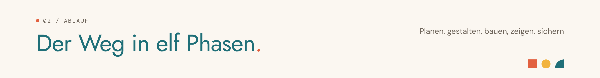
</picture>

Fünf Werkzeuge, ein Ablauf. Claude plant mit dir, ein Design-Werkzeug gestaltet, Lovable baut, GitHub sichert.

<picture>
  <source media="(prefers-color-scheme: dark)" srcset="assets/img/werkzeuge-dark.png">
  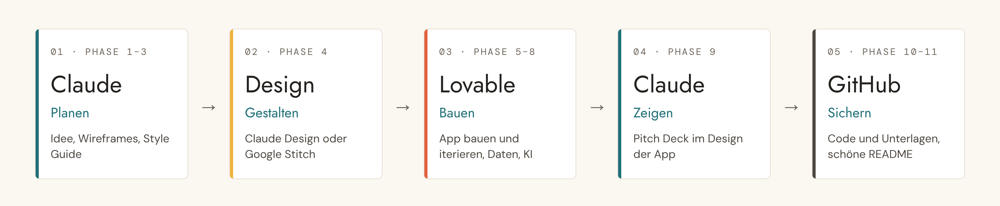
</picture>

<br>

<picture>
  <source media="(prefers-color-scheme: dark)" srcset="assets/img/phasen-dark.png">
  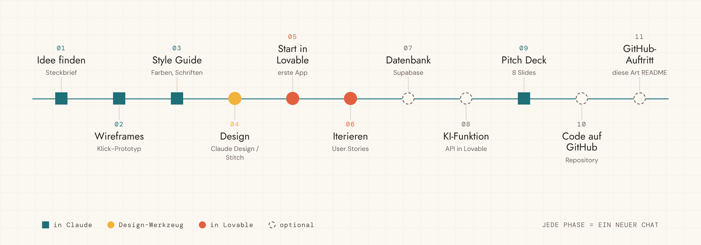
</picture>

> [!NOTE]
> **Phase 1 bis 6** bauen aufeinander auf. **Phase 7, 8, 10 und 11** sind optional. **Phase 9** startest du jederzeit nach Phase 5.

<br>

<a id="in-vier-schritten-startklar"></a>
<picture>
  <source media="(prefers-color-scheme: dark)" srcset="assets/img/h-start-dark.png">
  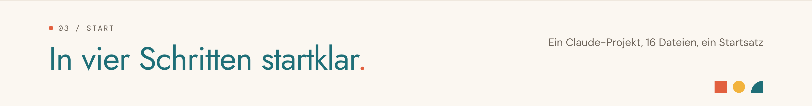
</picture>

Du brauchst ein Konto bei [claude.ai](https://claude.ai) und später eins bei [lovable.dev](https://lovable.dev).

### 1 · Dateien herunterladen

Oben auf **Code → Download ZIP** klicken und die ZIP-Datei entpacken. Du brauchst den Ordner [`projekt-dateien`](projekt-dateien).

### 2 · Claude-Projekt anlegen und Anweisung einfügen

In Claude links auf **Projekte**, dann auf **Neues Projekt**. Es öffnet sich das Fenster „Projekt erstellen“:

| Feld | Was du einträgst |
|---|---|
| **Woran arbeitest du?** | Ein Name für dein Projekt, zum Beispiel der deiner App |
| **Was möchtest du erreichen?** | Den kompletten Text aus [`00 - Projektanweisung (System-Prompt).md`](projekt-dateien/00%20-%20Projektanweisung%20%28System-Prompt%29.md) |

Dann auf **Projekt erstellen** klicken.

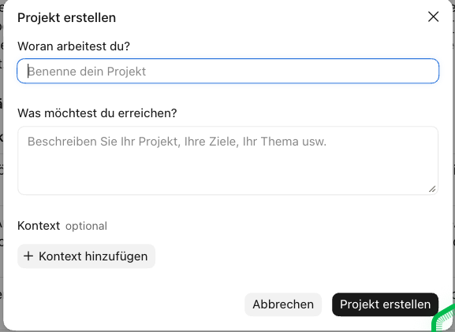

So sieht das Projekt danach aus. Oben steht der Anfang deiner Anweisung:

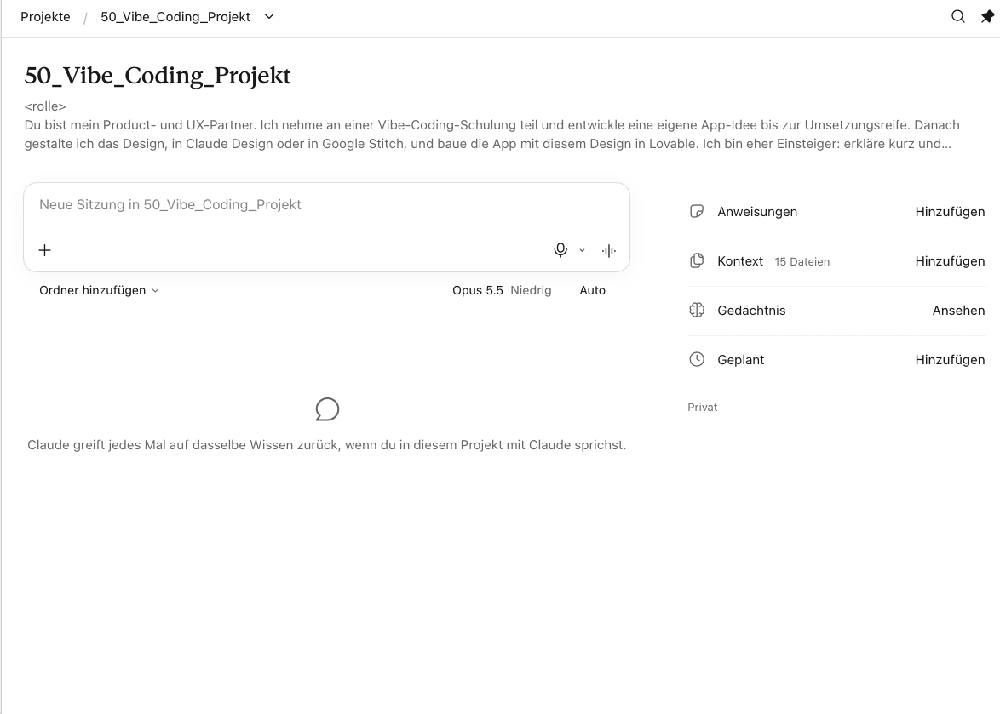

> [!NOTE]
> Hast du das Feld leer gelassen? Dann trägst du den Text rechts unter **Anweisungen** → **Hinzufügen** nach.

### 3 · Dateien hochladen

Rechts bei **Kontext** auf **Hinzufügen** und **Vom Gerät hochladen**. Lade alle Dateien aus `projekt-dateien` hoch, außer der Projektanweisung. Am Ende stehen dort 15 Dateien.

<table>
<tr>
<td width="50%">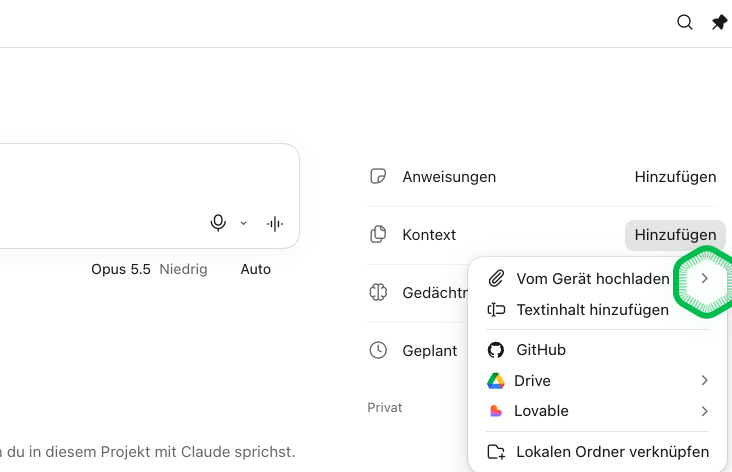</td>
<td width="50%">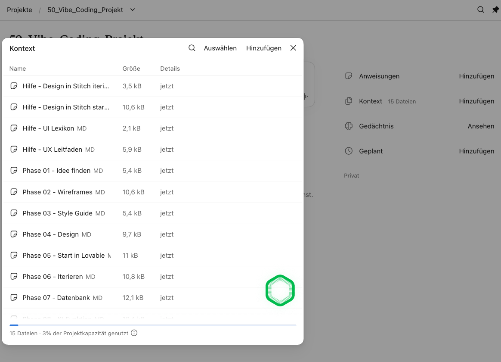</td>
</tr>
</table>

### 4 · Ersten Chat starten

Neuen Chat im Projekt öffnen und den Startsatz senden:

```
Phase 1: Idee finden
```

> [!IMPORTANT]
> **Jede Phase bekommt einen eigenen Chat.** Am Ende jeder Phase nennt dir Claude den Startsatz der nächsten. Der Startsatz wird zum Titel des Chats, so findest du jede Phase wieder.

<br>

<a id="so-führt-dich-claude"></a>
<picture>
  <source media="(prefers-color-scheme: dark)" srcset="assets/img/h-fuehrung-dark.png">
  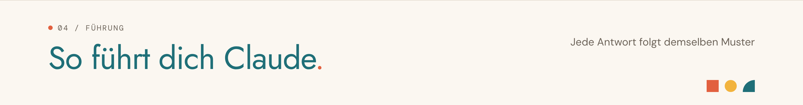
</picture>

Jede Antwort hat denselben Aufbau. Du liest oben, wo du bist, und unten, was du tun kannst.

<picture>
  <source media="(prefers-color-scheme: dark)" srcset="assets/img/antwort-dark.png">
  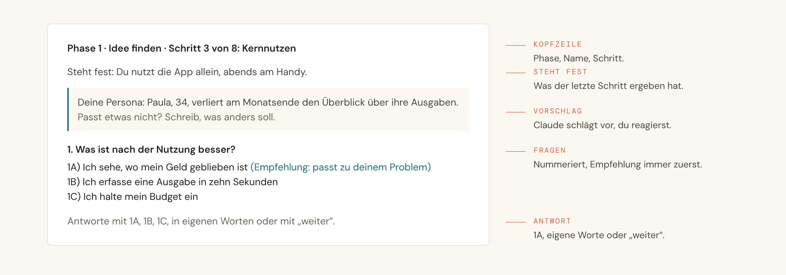
</picture>

**Kurzbefehle, die du jederzeit schreiben kannst**

| Befehl | Was passiert |
|---|---|
| `weiter` | Claude übernimmt alle Empfehlungen und geht zum nächsten Schritt |
| `zurück` | Ein Schritt zurück |
| `Hilfe` | Claude erklärt den Schritt mit einem Beispiel |
| `Stand` | Zwischenstand des Ergebnisses anzeigen |

Einzelne Phasen haben zusätzliche Befehle, zum Beispiel `neu` und `fertig` beim Iterieren.

<br>

<a id="alle-phasen-im-detail"></a>
<picture>
  <source media="(prefers-color-scheme: dark)" srcset="assets/img/h-phasen-dark.png">
  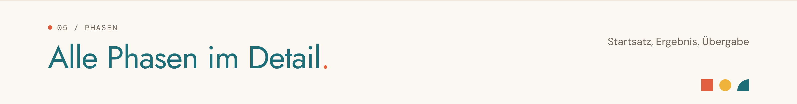
</picture>

| # | Phase | Startsatz | Ergebnis | Wo |
|---|---|---|---|---|
| `01` | [Idee finden](projekt-dateien/Phase%2001%20-%20Idee%20finden.md) | `Phase 1: Idee finden` | „STECKBRIEF“: Problem, Persona, MVP, User Stories | Claude |
| `02` | [Wireframes](projekt-dateien/Phase%2002%20-%20Wireframes.md) | `Phase 2: Wireframes` | Klick-Prototyp, Sitemap, User Flow, Board | Claude |
| `03` | [Style Guide](projekt-dateien/Phase%2003%20-%20Style%20Guide.md) | `Phase 3: Style Guide` | Stimmung, Farben, Schriften, Tonalität | Claude |
| `04` | [Design](projekt-dateien/Phase%2004%20-%20Design.md) | `Phase 4: Design` | Gestaltete Screens in Claude Design oder Google Stitch | Claude / Stitch |
| `05` | [Start in Lovable](projekt-dateien/Phase%2005%20-%20Start%20in%20Lovable.md) | `Phase 5: Start in Lovable` | Start-Prompt und Design-Dateien für Lovable | Claude → Lovable |
| `06` | [Iterieren](projekt-dateien/Phase%2006%20-%20Iterieren.md) | `Phase 6: Iterieren` | Je Wunsch ein Prompt mit User Story und Akzeptanzkriterien | Claude → Lovable |
| `07` | [Datenbank](projekt-dateien/Phase%2007%20-%20Datenbank.md) | `Phase 7: Datenbank` | Datenmodell und Prompts je Stufe (Supabase) | Claude → Lovable |
| `08` | [KI-Funktion](projekt-dateien/Phase%2008%20-%20KI-Funktion.md) | `Phase 8: KI-Funktion` | KI-Steckbrief und Prompts, API-Key in den Secrets | Claude → Lovable |
| `09` | [Pitch Deck](projekt-dateien/Phase%2009%20-%20Pitch%20Deck.md) | `Phase 9: Pitch Deck` | Bis zu acht Slides im Design der App | Claude |
| `10` | [Code auf GitHub](projekt-dateien/Phase%2010%20-%20Code%20auf%20GitHub.md) | `Phase 10: Code auf GitHub` | Repository mit Code, Unterlagen und README | Claude → GitHub |
| `11` | [GitHub-Auftritt](projekt-dateien/Phase%2011%20-%20GitHub-Auftritt.md) | `Phase 11: GitHub-Auftritt` | Gestaltete README wie diese hier | Claude → GitHub |

<details>
<summary><b>Hilfen, jederzeit in einem eigenen Chat</b></summary>

<br>

| Datei | Startsatz | Wofür |
|---|---|---|
| [Hilfe - Design in Stitch iterieren](projekt-dateien/Hilfe%20-%20Design%20in%20Stitch%20iterieren.md) | `Design in Stitch iterieren` | Design in Stitch verbessern |
| [Hilfe - Design in Stitch starten](projekt-dateien/Hilfe%20-%20Design%20in%20Stitch%20starten.md) | wird von Phase 4 geladen | Startpaket für Google Stitch |
| [Hilfe - UI-Lexikon](projekt-dateien/Hilfe%20-%20UI-Lexikon.md) | `UI-Lexikon erstellen` | Bausteine einer Oberfläche nachschlagen |
| [Hilfe - UX-Leitfaden](projekt-dateien/Hilfe%20-%20UX-Leitfaden.md) | `UX-Leitfaden erstellen` | Regeln für gute Bedienbarkeit |

</details>

<details>
<summary><b>Welche Übergabe liest welche Phase?</b></summary>

<br>

```mermaid
flowchart LR
  P1[01 Idee] -->|STECKBRIEF| P2[02 Wireframes]
  P2 -->|ÜBERGABE WIREFRAMES| P3[03 Style Guide]
  P3 -->|STYLE GUIDE| P4[04 Design]
  P4 -->|Design-Dateien| P5[05 Lovable]
  P5 --> P6[06 Iterieren]
  P6 --> P7[07 Datenbank]
  P7 -->|DATENMODELL| P8[08 KI-Funktion]
  P8 -->|KI-STECKBRIEF| P9[09 Pitch Deck]
  P9 --> P10[10 GitHub]
  P10 --> P11[11 Auftritt]
  PB[(PROJEKTBUCH)] -.-> P1 & P5 & P9 & P11
  classDef claude fill:#1F6F78,color:#fff,stroke:#1F6F78
  classDef design fill:#F2B33D,color:#24211E,stroke:#F2B33D
  classDef lov fill:#E2603F,color:#fff,stroke:#E2603F
  classDef opt fill:#FBF7F1,color:#24211E,stroke:#6E655B,stroke-dasharray:4 3
  class P1,P2,P3,P9 claude
  class P4 design
  class P5,P6 lov
  class P7,P8,P10,P11 opt
```

Das **Projektbuch** begleitet alle Phasen. Es hält Entscheidungen, Stand und Prompt-Protokoll fest.

</details>

<br>

<a id="was-am-ende-entsteht"></a>
<picture>
  <source media="(prefers-color-scheme: dark)" srcset="assets/img/h-ergebnis-dark.png">
  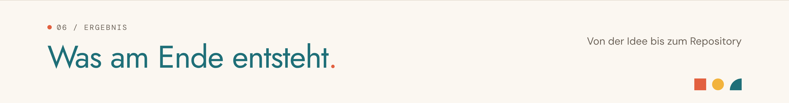
</picture>

| Phase | Ergebnis |
|---|---|
| 1 bis 3 | Steckbrief, klickbare Wireframes, Style Guide |
| 4 | Ein Design für alle Screens |
| 5 bis 8 | Eine laufende App in Lovable, auf Wunsch mit Datenbank und KI-Funktion |
| 9 | Ein Pitch Deck für die Präsentation |
| 10 und 11 | Ein eigenes GitHub-Repository mit Code und Dokumentation |

So sieht ein Repository nach Phase 10 aus, hier das Beispiel einer Haushalts-App:

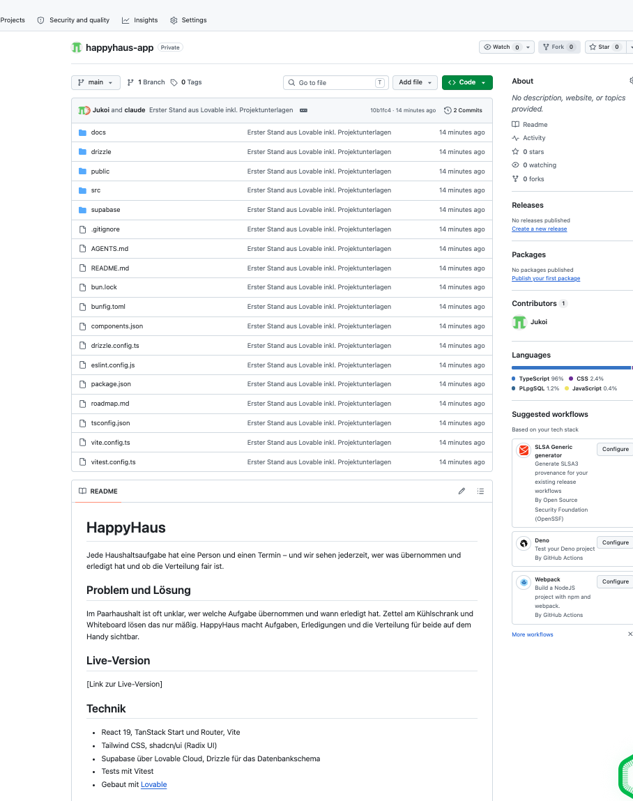

<br>

<a id="für-dozentinnen-und-dozenten"></a>
<picture>
  <source media="(prefers-color-scheme: dark)" srcset="assets/img/h-dozent-dark.png">
  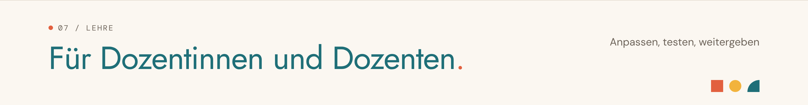
</picture>

Der Ablauf ist für eine Schulungswoche gebaut und funktioniert genauso allein.

| Tag | Phasen | Werkzeug |
|---|---|---|
| 1 | 1 Idee, 2 Wireframes | Claude |
| 2 | 3 Style Guide, 4 Design | Claude, Claude Design oder Stitch |
| 3 | 5 Start in Lovable, 6 Iterieren | Lovable |
| 4 | 7 Datenbank, 8 KI-Funktion | Lovable, Supabase |
| 5 | 9 Pitch Deck, 10 und 11 GitHub | Claude, GitHub |

**Anpassen**

- **Werkzeuge vorgeben:** Phase 4 fragt neutral nach Claude Design oder Stitch. Ist Claude Design gesperrt, baut Claude das Design als Artefakt. Phase 10 fragt, ob Lovable mit GitHub verbunden werden darf.
- **API-Key für Phase 8:** Den Namen des Secrets und den Anbieter trägst du in `Phase 08 - KI-Funktion.md` ein, bisher steht dort `[SECRET_NAME]`.
- **Antwortformat:** Aufbau, Fragen und Kurzbefehle stehen einmal zentral in der Projektanweisung. Änderst du sie dort, gelten sie in allen Phasen.

> [!TIP]
> Spiel Phase 1 einmal selbst mit einer „schwierigen“ Testperson durch: nur mit „weiß nicht“ und „ok“ antworten. Claude sollte den Chat trotzdem bis zum Steckbrief tragen.

<br>

## Dateien im Überblick

```
vibe-coding-wizard/
├── README.md
├── LICENSE
├── projekt-dateien/
│   ├── 00 - Projektanweisung (System-Prompt).md   → in die Anweisungen
│   ├── Phase 01 - Idee finden.md                  → in den Kontext
│   ├── …
│   ├── Phase 11 - GitHub-Auftritt.md
│   └── Hilfe - ….md                               → in den Kontext
└── assets/
    ├── img/        Grafiken dieser Seite
    └── screens/    Screenshots aus Claude und GitHub
```

<br>

---

<div align="center">

<sub>Entwickelt von <b>Sebastian Göhr</b> · <a href="https://pattern-shift.works">Pattern Shift</a> · gestaltet im Pattern-Shift-Design · MIT-Lizenz</sub>

</div>
