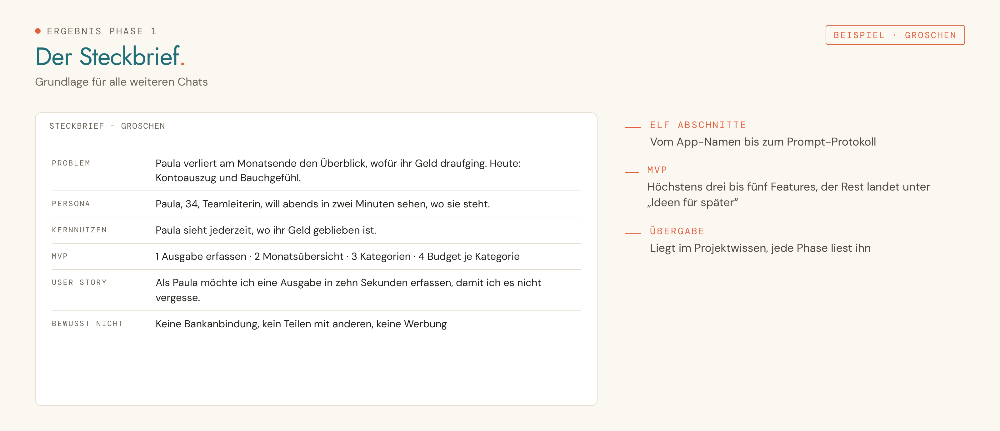

<picture>
  <source media="(prefers-color-scheme: dark)" srcset="../../assets/img/phase-01-dark.png">
  
</picture>

<p align="center"><sub><a href="../../README.md#alle-phasen-im-detail">Übersicht</a> · <a href="02-wireframes.md">02 Wireframes →</a></sub></p>

## Darum geht es

Aus einer groben Idee wird ein klarer Steckbrief: welches Problem die App löst, für wen und was sie im ersten Schritt kann.


## Startsatz

Neuer Chat im Projekt, dann senden:

```
Phase 1: Idee finden
```

## Das brauchst du

- Eine Idee, auch eine grobe. Ohne Idee hilft Claude mit Fragen zu deinem Alltag beim Finden.

## So läuft es

| # | Schritt | Was passiert |
|---|---|---|
| 1 | **Einstieg** | Du sagst, wo du stehst: keine, grobe oder konkrete Idee. |
| 2 | **Problem** | Welches Problem löst die App, und wie löst du es heute? |
| 3 | **Zielgruppe** | Wer nutzt die App? Claude beschreibt sie als Persona mit Situation, Ziel und Frust. |
| 4 | **Kernnutzen** | Was ist nach der Nutzung besser, in einem Satz. |
| 5 | **Kernfeatures** | Alle Ideen sammeln, höchstens drei bis fünf kommen ins MVP, der Rest nach „Später“. |
| 6 | **User Stories** | Pro MVP-Feature ein Satz nach dem Muster „Als … möchte ich …, damit …“. |
| 7 | **Daten** | Welche Daten braucht die App, woher kommen sie, was davon ist sensibel? |
| 8 | **Abgrenzung** | Was die App bewusst nicht macht. |
| 9 | **Wirkung und Projekttyp** | Drei Adjektive, Nutzungssituation, Projekttyp. |
| 10 | **Realitätscheck** | Würdest du die App nutzen? Ist der MVP in wenigen Tagen machbar? |

## Das kommt raus

So sieht das Ergebnis aus, am Beispiel der erfundenen Haushaltsbuch-App „Groschen“:

<picture>
  <source media="(prefers-color-scheme: dark)" srcset="../../assets/img/beispiel-01-dark.png">
  
</picture>

| Ergebnis | Inhalt | Wofür |
|---|---|---|
| **STECKBRIEF – [App-Name]** | Problem, Persona, Kernnutzen, MVP mit User Stories, Daten, Abgrenzung, Wirkung, Ideen für später | Übergabe für alle weiteren Phasen |
| **PROJEKTBUCH – [App-Name]** | Logbuch mit Entscheidungen, Stand und Prompt-Protokoll | läuft durch alle Phasen mit |

## Dein Teil

- [ ] Nichts hochladen, wenn Claude selbst im Projektwissen speichern kann. Sonst Steckbrief und Projektbuch herunterladen und unter „Kontext“ hochladen.

## Tipps

> [!TIP]
> Antworte ruhig mit „weiß nicht“: Claude zeigt dir dann zwei konkrete Varianten.

> [!TIP]
> Bau etwas, das du selbst nutzen willst. Du darfst deine eigene wichtigste Nutzerin sein.

> [!TIP]
> Bei Gesundheits- oder Finanzdaten zum Bauen mit Beispieldaten starten.

---

<sub>Der vollständige Phasen-Prompt: [`Phase 01 - Idee finden.md`](../../projekt-dateien/Phase%2001%20-%20Idee%20finden.md) · [Übersicht](../../README.md#alle-phasen-im-detail) · [02 Wireframes →](02-wireframes.md)</sub>
