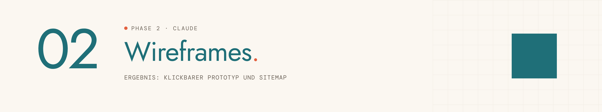
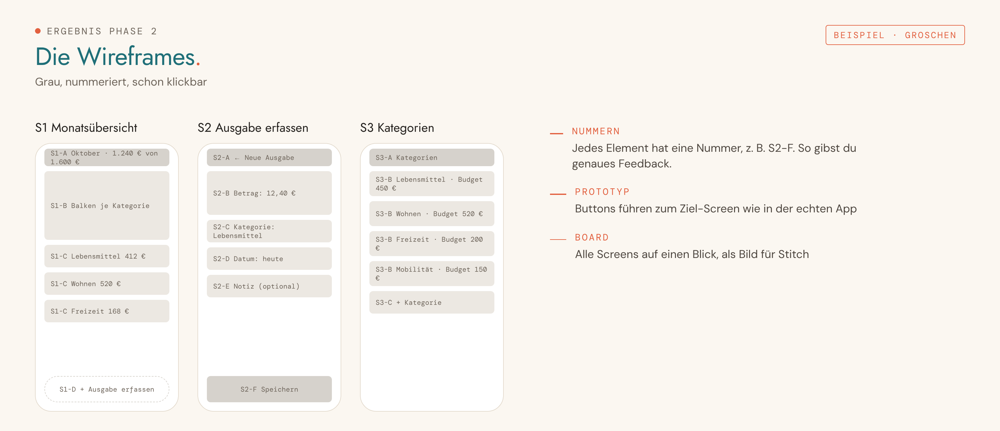

<picture>
  <source media="(prefers-color-scheme: dark)" srcset="../../assets/img/phase-02-dark.png">
  
</picture>

<p align="center"><sub><a href="01-idee-finden.md">← 01 Idee finden</a> · <a href="../../README.md#alle-phasen-im-detail">Übersicht</a> · <a href="03-style-guide.md">03 Style Guide →</a></sub></p>

## Darum geht es

Aus dem Steckbrief werden Screens, eine Sitemap, ein User Flow und graue Wireframes, die du schon durchklicken kannst.


## Startsatz

> [!IMPORTANT]
> **Neuer Chat für diese Phase.** Öffne im Projekt einen neuen Chat und sende dort den Startsatz. Nie im Chat der vorherigen Phase weitermachen.


```
Phase 2: Wireframes
```

## Das brauchst du

- „STECKBRIEF – [App-Name]“ aus Phase 1

## So läuft es

| # | Schritt | Was passiert |
|---|---|---|
| 1 | **Projekttyp und Viewports** | Für welche Bildschirmbreite zuerst gestaltet wird: Handy, Desktop oder Tablet. |
| 2 | **Screen-Liste** | Alle nötigen Screens, höchstens acht, jeder mit Zweck. |
| 3 | **Sitemap** | Die Struktur als Baum: Hauptbereiche, Unterseiten, Overlays. |
| 4 | **User Flow** | Der Weg der Persona durch die Screens, Hauptweg zuerst. |
| 5 | **Navigation** | Zwei Muster zur Wahl, z. B. untere Tab-Leiste oder Seitenleiste. |
| 6 | **Wireframes** | Die Screens in Gruppen von zwei bis drei, mit echten Texten statt Lorem ipsum. |
| 7 | **Logik prüfen** | Was passiert ohne Daten, nach dem Löschen, bei Fehlern? |
| 8 | **Zweiter Viewport** | Die wichtigsten Screens in der zweiten Bildschirmbreite. |
| 9 | **Durchklicken** | Du klickst den Prototyp einmal komplett durch. |

## Das kommt raus

So sieht das Ergebnis aus, am Beispiel der erfundenen Haushaltsbuch-App „Groschen“:

<picture>
  <source media="(prefers-color-scheme: dark)" srcset="../../assets/img/beispiel-02-dark.png">
  
</picture>

| Ergebnis | Inhalt | Wofür |
|---|---|---|
| **WIREFRAMES – [App-Name]** | Ein Artefakt mit drei Ansichten: Übersicht, klickbarer Prototyp, Board mit allen Screens | Grundlage für Design und Lovable |
| **ÜBERGABE WIREFRAMES – [App-Name]** | Sitemap, User Flow und alle Screens mit Nummern und Notizen als Text | Übergabe für Phase 3 bis 11 |
| **WIREFRAMES – [App-Name].png** | Screenshot des Boards | nur nötig, wenn du in Phase 4 Stitch wählst |
| **Wireframe-Datei** | Das Artefakt als Datei | Anhang in Phase 5 für Lovable |

## Dein Teil

- [ ] Screenshot vom Board machen und speichern.
- [ ] Das Wireframe-Artefakt über sein Menü als Datei herunterladen.

## Tipps

> [!TIP]
> Feedback gibst du mit Nummern, z. B. „S2-B weg, dafür eine Suchleiste“.

> [!TIP]
> Eine Papierskizze oder ein Screenshot einer App, die dir gefällt, darf jederzeit mit in den Chat.

---

<sub>Der vollständige Phasen-Prompt: [`Phase 02 - Wireframes.md`](../../projekt-dateien/Phase%2002%20-%20Wireframes.md) · [← 01 Idee finden](01-idee-finden.md) · [Übersicht](../../README.md#alle-phasen-im-detail) · [03 Style Guide →](03-style-guide.md)</sub>
