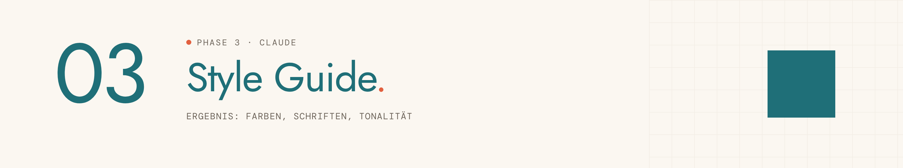
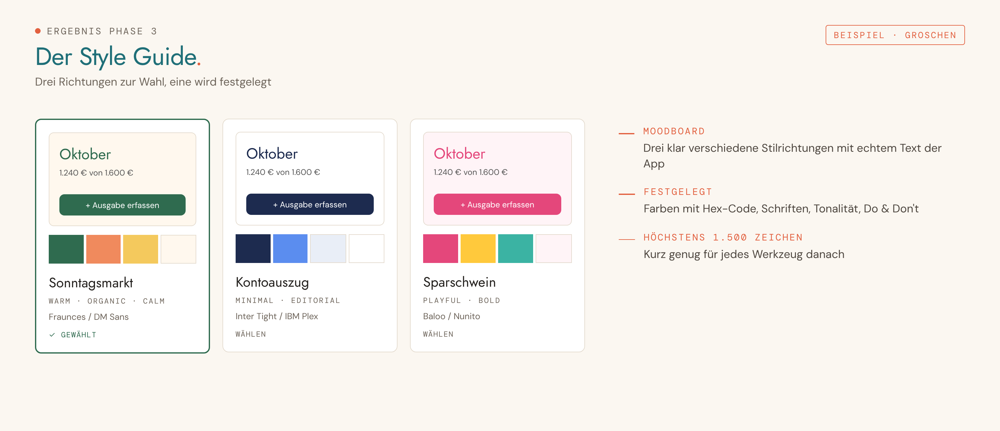

<picture>
  <source media="(prefers-color-scheme: dark)" srcset="../../assets/img/phase-03-dark.png">
  
</picture>

<p align="center"><sub><a href="02-wireframes.md">← 02 Wireframes</a> · <a href="../../README.md#alle-phasen-im-detail">Übersicht</a> · <a href="04-design.md">04 Design →</a></sub></p>

## Darum geht es

Du legst Stimmung, Farben, Schriften und Tonalität deiner App fest. Die Details gestaltet Phase 4.


## Startsatz

Neuer Chat im Projekt, dann senden:

```
Phase 3: Style Guide
```

## Das brauchst du

- „STECKBRIEF – [App-Name]“
- „ÜBERGABE WIREFRAMES – [App-Name]“

## So läuft es

| # | Schritt | Was passiert |
|---|---|---|
| 1 | **Stimmung und Vorbilder** | Du nennst Apps oder Marken, die du magst. Claude zeigt drei Stilrichtungen als Moodboard. |
| 2 | **Farben** | Zwei, drei Paletten mit Rollen: Primär, Akzent, Hintergrund, Text. |
| 3 | **Schriften** | Drei Schriftpaare mit echtem Text aus deiner App, nur Google Fonts. |
| 4 | **Tonalität** | Du oder Sie, locker oder sachlich, mit Beispielsätzen aus deinen Screens. |

## Das kommt raus

So sieht das Ergebnis aus, am Beispiel der erfundenen Haushaltsbuch-App „Groschen“:

<picture>
  <source media="(prefers-color-scheme: dark)" srcset="../../assets/img/beispiel-03-dark.png">
  
</picture>

| Ergebnis | Inhalt | Wofür |
|---|---|---|
| **STYLE GUIDE – [App-Name]** | Höchstens 1.500 Zeichen: Stimmung, Vorbilder, Farben mit Hex-Code, Schriften, Tonalität, Do & Don't | Übergabe für Design, Lovable und Pitch Deck |

## Dein Teil

- [ ] Nichts, wenn Claude selbst speichern kann.

## Tipps

> [!TIP]
> Reagier einfach: „zu kühl“, „mehr davon“, „zu verspielt“. Claude übersetzt das in Werte.

> [!TIP]
> Text muss gut lesbar bleiben: Claude prüft den Kontrast nach WCAG AA.

---

<sub>Der vollständige Phasen-Prompt: [`Phase 03 - Style Guide.md`](../../projekt-dateien/Phase%2003%20-%20Style%20Guide.md) · [← 02 Wireframes](02-wireframes.md) · [Übersicht](../../README.md#alle-phasen-im-detail) · [04 Design →](04-design.md)</sub>
