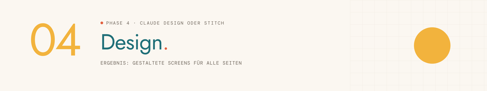

<picture>
  <source media="(prefers-color-scheme: dark)" srcset="../../assets/img/phase-04-dark.png">
  
</picture>

<p align="center"><sub><a href="03-style-guide.md">← 03 Style Guide</a> · <a href="../../README.md#alle-phasen-im-detail">Übersicht</a> · <a href="05-start-in-lovable.md">05 Start in Lovable →</a></sub></p>

## Darum geht es

Aus Wireframes und Style Guide werden gestaltete Screens. Du wählst zuerst, wo das Design entsteht.


## Startsatz

Neuer Chat im Projekt, dann senden:

```
Phase 4: Design
```

## Das brauchst du

- Steckbrief, Wireframe-Übergabe und Style Guide
- Für Stitch: ein Google-Konto und das Wireframe-Bild aus Phase 2

## So läuft es

| # | Schritt | Was passiert |
|---|---|---|
| 1 | **Weiche** | „Wo möchtest du das Design entwickeln?“ In Claude Design oder in Google Stitch, neutral zur Wahl. |
| 2 | **Prüfen** | Übergaben, Viewport und Haupt-Screen. |
| 3 | **Richtung wählen** | Der Haupt-Screen in drei Varianten als Karten zum Anklicken. |
| 4 | **Haupt-Screen fertig machen** | Feinschliff, bis es passt. |
| 5 | **Alle Screens** | Die übrigen Screens im gewählten Stil, mit den Nummern aus den Wireframes. |
| 6 | **Zweiter Viewport** | Die wichtigsten Screens in der zweiten Breite. |
| 7 | **Übergabe vorbereiten** | Als Datei oder direkt an Lovable. |

## Das kommt raus

| Ergebnis | Inhalt | Wofür |
|---|---|---|
| **DESIGN – [App-Name]** | Alle Screens gestaltet, in Claude Design oder als Artefakt | geht als Datei oder direkt an Lovable |
| **Style Guide mit „Stand nach Design“** | Die finalen Farben und Schriften aus dem Design | gilt für alle weiteren Phasen |
| **Stitch-Weg: DESIGN.md und Prompts** | Texte zum Kopieren nach Stitch, danach der Code der Screens | Mitbringen in Phase 5 |

## Dein Teil

- [ ] Design als Datei herunterladen oder an Lovable schicken, laut Anleitung in der Abschlussantwort.
- [ ] Beim Stitch-Weg: in Stitch gestalten und den Code der Screens holen.

## Tipps

> [!TIP]
> Ist Claude Design gesperrt, baut Claude das Design als Artefakt. Der Ablauf bleibt gleich.

> [!TIP]
> Mit „mutiger“ und „feiner“ steuerst du, wie groß die Sprünge sind.

> [!TIP]
> Große Änderungen am Aussehen jetzt machen: In Lovable kosten sie Credits.

---

<sub>Der vollständige Phasen-Prompt: [`Phase 04 - Design.md`](../../projekt-dateien/Phase%2004%20-%20Design.md) · [← 03 Style Guide](03-style-guide.md) · [Übersicht](../../README.md#alle-phasen-im-detail) · [05 Start in Lovable →](05-start-in-lovable.md)</sub>
