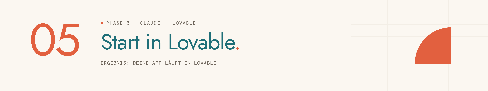
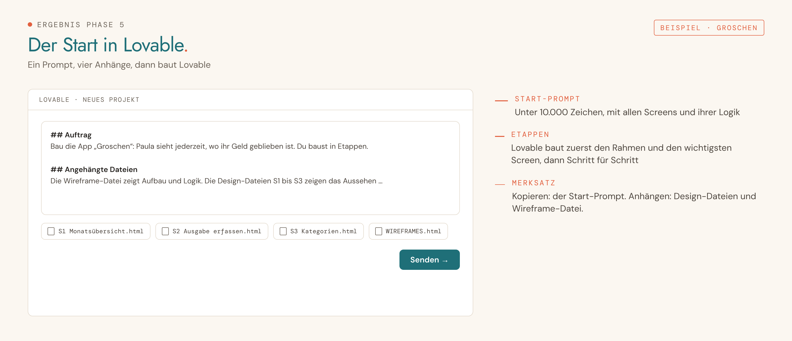

<picture>
  <source media="(prefers-color-scheme: dark)" srcset="../../assets/img/phase-05-dark.png">
  
</picture>

<p align="center"><sub><a href="04-design.md">← 04 Design</a> · <a href="../../README.md#alle-phasen-im-detail">Übersicht</a> · <a href="06-iterieren.md">06 Iterieren →</a></sub></p>

## Darum geht es

Du bekommst in einer einzigen Antwort alles, um deine App in Lovable zu starten: Start-Prompt, Design-Dateien und Anleitung.


## Startsatz

Neuer Chat im Projekt, dann senden:

```
Phase 5: Start in Lovable
```

## Das brauchst du

- Dein Design aus Phase 4
- Die Wireframe-Datei aus Phase 2
- Ein Konto bei lovable.dev

## So läuft es

| # | Schritt | Was passiert |
|---|---|---|
| 1 | **Prüfen und Weg wählen** | Claude ordnet das Design den Screens zu und klärt Abweichungen. |
| 2 | **Start-Prompt** | Ein Prompt unter 10.000 Zeichen, der Lovable in Etappen bauen lässt. |
| 3 | **Abschluss** | Eine Antwort mit Tabelle „Was, Woher, Wohin“, Anleitung und allen Dateien. |

## Das kommt raus

So sieht das Ergebnis aus, am Beispiel der erfundenen Haushaltsbuch-App „Groschen“:

<picture>
  <source media="(prefers-color-scheme: dark)" srcset="../../assets/img/beispiel-05-dark.png">
  
</picture>

| Ergebnis | Inhalt | Wofür |
|---|---|---|
| **Start-Prompt** | Auftrag, Produkt, Screens mit Logik, Design-Regeln, Etappen | in Lovable ins große Eingabefeld |
| **Design-Dateien** | Die Screens als HTML, sauber benannt | Anhang in Lovable |
| **Deine App in Lovable** | Gebaut Etappe für Etappe | weiter in Phase 6 |

## Dein Teil

- [ ] Start-Prompt kopieren, Design-Dateien und Wireframe-Datei anhängen, senden.
- [ ] Rückfragen von Lovable beantworten und nach jeder Etappe „weiter“ schreiben.

## Tipps

> [!TIP]
> Merksatz: Kopieren musst du nur den Start-Prompt. Anhängen: Design-Dateien und Wireframe-Datei.

> [!TIP]
> Liegt dein Design schon in Lovable, wird der Start-Prompt zur ersten Nachricht in diesem Projekt.

---

<sub>Der vollständige Phasen-Prompt: [`Phase 05 - Start in Lovable.md`](../../projekt-dateien/Phase%2005%20-%20Start%20in%20Lovable.md) · [← 04 Design](04-design.md) · [Übersicht](../../README.md#alle-phasen-im-detail) · [06 Iterieren →](06-iterieren.md)</sub>
