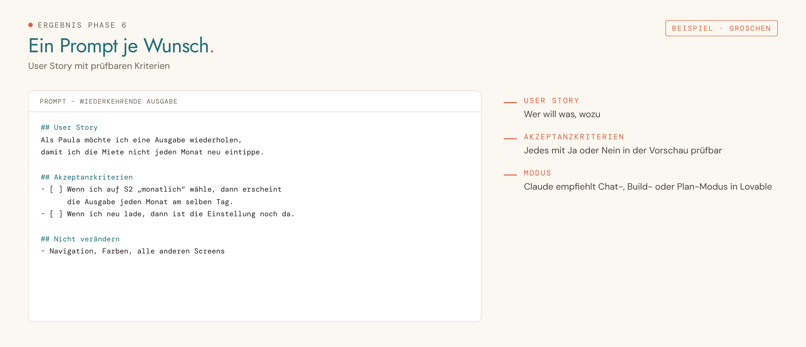

<picture>
  <source media="(prefers-color-scheme: dark)" srcset="../../assets/img/phase-06-dark.png">
  
</picture>

<p align="center"><sub><a href="05-start-in-lovable.md">← 05 Start in Lovable</a> · <a href="../../README.md#alle-phasen-im-detail">Übersicht</a> · <a href="07-datenbank.md">07 Datenbank →</a></sub></p>

## Darum geht es

Jeder Änderungswunsch wird zu einer User Story mit Akzeptanzkriterien und einem fertigen Prompt für Lovable. Du lernst, in User Stories zu denken.


## Startsatz

> [!IMPORTANT]
> **Neuer Chat für diese Phase.** Öffne im Projekt einen neuen Chat und sende dort den Startsatz. Nie im Chat der vorherigen Phase weitermachen.


```
Phase 6: Iterieren
```

## Das brauchst du

- Deine App in Lovable
- Bei Aussehen oder Fehlern: einen Screenshot aus der Lovable-Vorschau

## So läuft es

| # | Schritt | Was passiert |
|---|---|---|
| 1 | **Wunsch einordnen** | Neues Feature, Änderung, Fehler oder kleine Textkorrektur. |
| 2 | **Zuschnitt** | Zu große Wünsche werden in mehrere Stories geteilt. |
| 3 | **Ist-Stand** | Wie sieht der Bereich heute aus, was passiert genau? |
| 4 | **User Story** | „Als … möchte ich …, damit …“, auf Wunsch formulierst du selbst. |
| 5 | **Akzeptanzkriterien** | Drei bis sieben Sätze „Wenn …, dann …“, jeder mit Ja oder Nein prüfbar. |
| 6 | **Abgrenzung** | Was unverändert bleibt und welcher Anhang mitgeht. |
| 7 | **Prompt und Modus** | Fertiger Prompt plus Empfehlung: Chat-, Build- oder Plan-Modus. |

## Das kommt raus

So sieht das Ergebnis aus, am Beispiel der erfundenen Haushaltsbuch-App „Groschen“:

<picture>
  <source media="(prefers-color-scheme: dark)" srcset="../../assets/img/beispiel-06-dark.png">
  
</picture>

| Ergebnis | Inhalt | Wofür |
|---|---|---|
| **PROMPT – [Kurzname]** | User Story, Kontext, Akzeptanzkriterien, Gestaltung, „Nicht verändern“ | in Lovable einfügen |
| **Projektbuch** | Mit „fertig“ trägt Claude umgesetzte Stories und Merke-dir-Regeln ein | bleibt im Projektwissen |

## Dein Teil

- [ ] Prompt im empfohlenen Modus in Lovable senden.
- [ ] Jedes Akzeptanzkriterium in der Vorschau abhaken, dann die Version als Lesezeichen sichern.

## Tipps

> [!TIP]
> Kleine Änderung an einem Screen? Claude nimmt den Schnellweg mit einem einzigen Vorschlag.

> [!TIP]
> Scheitert Lovable zweimal am selben Punkt: zur letzten guten Version zurück und die Story kleiner schneiden.

> [!TIP]
> Kleine Textkorrekturen machst du direkt in der Lovable-Vorschau, ganz ohne Prompt.

---

<sub>Der vollständige Phasen-Prompt: [`Phase 06 - Iterieren.md`](../../projekt-dateien/Phase%2006%20-%20Iterieren.md) · [← 05 Start in Lovable](05-start-in-lovable.md) · [Übersicht](../../README.md#alle-phasen-im-detail) · [07 Datenbank →](07-datenbank.md)</sub>
