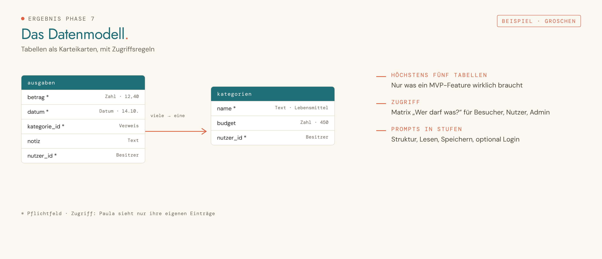

<picture>
  <source media="(prefers-color-scheme: dark)" srcset="../../assets/img/phase-07-dark.png">
  
</picture>

<p align="center"><sub><a href="06-iterieren.md">← 06 Iterieren</a> · <a href="../../README.md#alle-phasen-im-detail">Übersicht</a> · <a href="08-ki-funktion.md">08 KI-Funktion →</a></sub></p>

## Darum geht es

Du findest heraus, welche Daten deine App dauerhaft speichern muss, und bereitest die Datenbank mit Supabase in Lovable vor. „Keine Datenbank“ ist ein erlaubtes Ergebnis.

> [!NOTE]
> Diese Phase ist optional.

## Startsatz

> [!IMPORTANT]
> **Neuer Chat für diese Phase.** Öffne im Projekt einen neuen Chat und sende dort den Startsatz. Nie im Chat der vorherigen Phase weitermachen.


```
Phase 7: Datenbank
```

## Das brauchst du

- Deine App in Lovable
- Steckbrief, Wireframe-Übergabe, Projektbuch

## So läuft es

| # | Schritt | Was passiert |
|---|---|---|
| 1 | **Bestand** | Welche Daten zeigt, nimmt oder ändert jeder Screen? |
| 2 | **Brauche ich eine Datenbank?** | Drei Fragen als Ampel. |
| 3 | **Datenbereiche wählen** | Karten wie Inhalte, Bilder, Nutzerkonten, Formulare, Nutzung. |
| 4 | **Tabellen und Felder** | Als Karteikarten mit Beispielwerten, höchstens fünf Tabellen. |
| 5 | **Bilder und Dateien** | Was in den Storage gehört, wer hochladen darf, was öffentlich ist. |
| 6 | **Zugriff und Datenschutz** | Matrix „Wer darf was?“ für Besucher, Nutzer, Admin. |
| 7 | **Pflege und Nutzung** | Wie Inhalte reinkommen, ob etwas gemessen wird. |
| 8 | **Prompts für Lovable** | Einbau in Stufen: Struktur, Lesen, Speichern, optional Login und Messen. |

## Das kommt raus

So sieht das Ergebnis aus, am Beispiel der erfundenen Haushaltsbuch-App „Groschen“:

<picture>
  <source media="(prefers-color-scheme: dark)" srcset="../../assets/img/beispiel-07-dark.png">
  
</picture>

| Ergebnis | Inhalt | Wofür |
|---|---|---|
| **DATENMODELL – [App-Name]** | Tabellen, Felder, Storage, Zugriffsregeln, Datenschutz | Übergabe für Phase 8 bis 11 |
| **PROMPT – Daten · Stufe 1 bis n** | Ein Prompt je Stufe | in Lovable, Stufe 1 im Plan-Modus |
| **Anleitung Supabase** | So aktivierst und prüfst du die Datenbank | vor Stufe 1 |

## Dein Teil

- [ ] Vor dem Einbau in Lovable eine Version als Lesezeichen sichern.
- [ ] Nach jeder Stufe testen, auch im privaten Browserfenster ohne Login.

## Tipps

> [!TIP]
> Geheime Schlüssel gehören in die Secrets von Lovable, nie in einen Chat.

> [!TIP]
> Sensible Daten zuerst mit Beispieldaten testen.

---

<sub>Der vollständige Phasen-Prompt: [`Phase 07 - Datenbank.md`](../../projekt-dateien/Phase%2007%20-%20Datenbank.md) · [← 06 Iterieren](06-iterieren.md) · [Übersicht](../../README.md#alle-phasen-im-detail) · [08 KI-Funktion →](08-ki-funktion.md)</sub>
