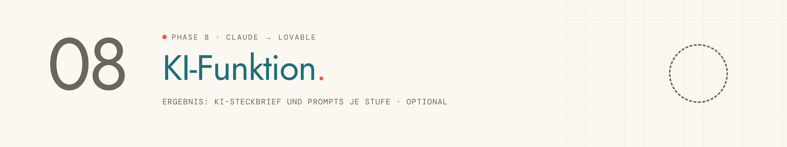

<picture>
  <source media="(prefers-color-scheme: dark)" srcset="../../assets/img/phase-08-dark.png">
  
</picture>

<p align="center"><sub><a href="07-datenbank.md">← 07 Datenbank</a> · <a href="../../README.md#alle-phasen-im-detail">Übersicht</a> · <a href="09-pitch-deck.md">09 Pitch Deck →</a></sub></p>

## Darum geht es

Du findest eine KI-Funktion, die deiner Persona echte Mühe spart, und baust sie sicher in Lovable ein.

> [!NOTE]
> Diese Phase ist optional.

## Startsatz

Neuer Chat im Projekt, dann senden:

```
Phase 8: KI-Funktion
```

## Das brauchst du

- Deine App in Lovable
- Einen API-Key, z. B. von deinem Dozenten
- Falls vorhanden: das Datenmodell aus Phase 7

## So läuft es

| # | Schritt | Was passiert |
|---|---|---|
| 1 | **Bestand** | Was tut der Nutzer auf welchem Screen, welche Daten liegen dort? |
| 2 | **Eigene Idee** | Hast du schon eine Idee, oder willst du Vorschläge? |
| 3 | **Brainstorming** | Fünf bis sieben Ideen als Karten mit Beispiel-Eingabe und -Antwort. |
| 4 | **Bewerten** | Ampel für Nutzen, Machbarkeit, Daten und Passung. |
| 5 | **Verhalten festlegen** | Wo, was rein, was raus, Tonalität, Verbote, Zustände. |
| 6 | **System-Prompt** | Die feste Anweisung für die KI, auf Wunsch schreibst du sie selbst. |
| 7 | **Prompts für Lovable** | Einbau in drei Stufen: Oberfläche, Anbindung, Zustände. |

## Das kommt raus

| Ergebnis | Inhalt | Wofür |
|---|---|---|
| **KI-STECKBRIEF – [App-Name]** | Funktion, Ein- und Ausgabe, System-Prompt, Grenzen, Datenschutz | Übergabe für Phase 9 bis 11 |
| **PROMPT – KI · Stufe 1 bis 3** | Ein Prompt je Stufe | in Lovable, Stufe 2 im Plan-Modus |
| **Anleitung Secrets** | So trägst du den API-Key in Lovable ein | vor Stufe 2 |

## Dein Teil

- [ ] API-Key nur in Lovable unter Secrets eintragen, nirgends sonst.

## Tipps

> [!TIP]
> Die KI wird nur auf Klick ausgelöst. Das hält die Kosten im Blick.

> [!TIP]
> Unter jeder Antwort steht „KI-generiert, bitte prüfen“.

---

<sub>Der vollständige Phasen-Prompt: [`Phase 08 - KI-Funktion.md`](../../projekt-dateien/Phase%2008%20-%20KI-Funktion.md) · [← 07 Datenbank](07-datenbank.md) · [Übersicht](../../README.md#alle-phasen-im-detail) · [09 Pitch Deck →](09-pitch-deck.md)</sub>
