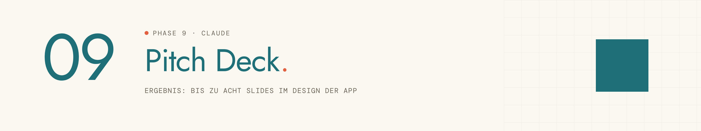
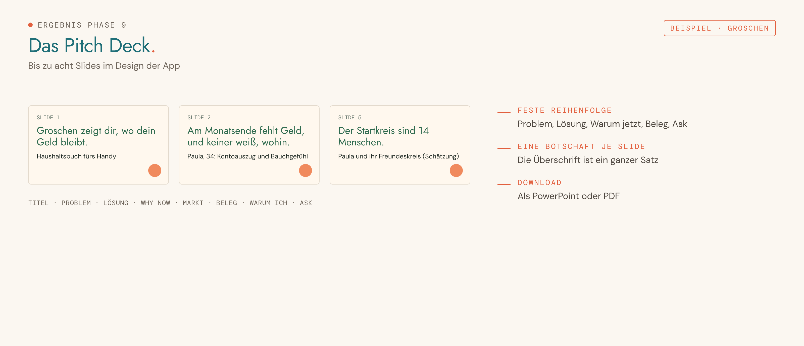

<picture>
  <source media="(prefers-color-scheme: dark)" srcset="../../assets/img/phase-09-dark.png">
  
</picture>

<p align="center"><sub><a href="08-ki-funktion.md">← 08 KI-Funktion</a> · <a href="../../README.md#alle-phasen-im-detail">Übersicht</a> · <a href="10-code-auf-github.md">10 Code auf GitHub →</a></sub></p>

## Darum geht es

Du erzählst deine Idee in höchstens acht Slides so, dass andere sie in wenigen Minuten verstehen. Das Deck hat das Design deiner App.


## Startsatz

Neuer Chat im Projekt, dann senden:

```
Phase 9: Pitch Deck
```

## Das brauchst du

- Steckbrief, Style Guide, Projektbuch
- Zwei, drei Screenshots aus der Lovable-Vorschau

## So läuft es

| # | Schritt | Was passiert |
|---|---|---|
| 1 | **Anlass und Zeit** | Abschlusspräsentation, Partnergespräch oder Investoren-Teaser. |
| 2 | **Kernsatz** | Drei Varianten für den Ein-Satz-Pitch. |
| 3 | **Inhalte** | Titel, Problem, Lösung, Why now, Markt, Beleg, Warum ich, Ask. |
| 4 | **Storyline prüfen** | Die Überschriften allein müssen die Geschichte erzählen. |
| 5 | **Deck bauen** | Mit Slides in Claude, in Farben und Schriften deiner App. |
| 6 | **Sprechtext** | Zwei, drei Stichpunkte je Slide. |

## Das kommt raus

So sieht das Ergebnis aus, am Beispiel der erfundenen Haushaltsbuch-App „Groschen“:

<picture>
  <source media="(prefers-color-scheme: dark)" srcset="../../assets/img/beispiel-09-dark.png">
  
</picture>

| Ergebnis | Inhalt | Wofür |
|---|---|---|
| **PITCH DECK – [App-Name]** | Bis zu acht Slides mit Sprechtext | als PowerPoint oder PDF herunterladbar |

## Dein Teil

- [ ] Deck herunterladen und einmal laut durchgehen.

## Tipps

> [!TIP]
> Die Marktfolie darf augenzwinkernd sein: Der Startkreis sind vielleicht 14 Personen.

> [!TIP]
> Keine erfundenen Zahlen: Schätzungen sind als Schätzung markiert.

---

<sub>Der vollständige Phasen-Prompt: [`Phase 09 - Pitch Deck.md`](../../projekt-dateien/Phase%2009%20-%20Pitch%20Deck.md) · [← 08 KI-Funktion](08-ki-funktion.md) · [Übersicht](../../README.md#alle-phasen-im-detail) · [10 Code auf GitHub →](10-code-auf-github.md)</sub>
