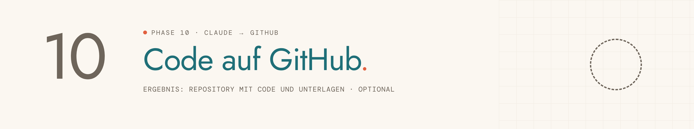

<picture>
  <source media="(prefers-color-scheme: dark)" srcset="../../assets/img/phase-10-dark.png">
  
</picture>

<p align="center"><sub><a href="09-pitch-deck.md">← 09 Pitch Deck</a> · <a href="../../README.md#alle-phasen-im-detail">Übersicht</a> · <a href="11-github-auftritt.md">11 GitHub-Auftritt →</a></sub></p>

## Darum geht es

Dein Code und deine Projektunterlagen landen sicher in einem eigenen GitHub-Repository.

> [!NOTE]
> Diese Phase ist optional.

## Startsatz

Neuer Chat im Projekt, dann senden:

```
Phase 10: Code auf GitHub
```

## Das brauchst du

- Ein GitHub-Konto oder fünf Minuten, um eins anzulegen
- Deine App in Lovable

## So läuft es

| # | Schritt | Was passiert |
|---|---|---|
| 1 | **GitHub-Konto** | Vorhanden oder neu anlegen. |
| 2 | **Sichtbarkeit** | Privat oder öffentlich. |
| 3 | **Name und Beschreibung** | Drei Vorschläge aus dem App-Namen. |
| 4 | **GitHub-Verbindung in Lovable** | Darf Lovable bei dir mit GitHub verbunden werden? Daraus folgt der Weg „Verbunden“ oder „Momentaufnahme“. |
| 5 | **Code ins Repo** | Eins zu eins, ohne `.env` und ohne Schlüssel. |
| 6 | **Inhalt prüfen** | Ordnerstruktur und Sicherheits-Check. |
| 7 | **README** | Eine schlichte Startseite. |
| 8 | **Hochladen** | Direkt durch Claude oder per Anleitung im Browser. |

## Das kommt raus

| Ergebnis | Inhalt | Wofür |
|---|---|---|
| **GitHub-Repository** | Code, `docs/` mit allen Übergaben, README | bleibt dein Archiv und Portfolio |
| **Grundwissen** | History, Einladen, Aktualisieren, Zwei-Faktor-Anmeldung | in der Abschlussantwort |

## Dein Teil

- [ ] Beim Weg „Verbunden“: in Lovable auf „GitHub“ → „Connect“.
- [ ] Beim Weg „Momentaufnahme“: Code als ZIP aus Lovable herunterladen.

## Tipps

> [!TIP]
> Starte privat. Öffentlich machen geht später mit zwei Klicks.

> [!TIP]
> Lade nie Passwörter oder Keys ins Repo.

---

<sub>Der vollständige Phasen-Prompt: [`Phase 10 - Code auf GitHub.md`](../../projekt-dateien/Phase%2010%20-%20Code%20auf%20GitHub.md) · [← 09 Pitch Deck](09-pitch-deck.md) · [Übersicht](../../README.md#alle-phasen-im-detail) · [11 GitHub-Auftritt →](11-github-auftritt.md)</sub>
