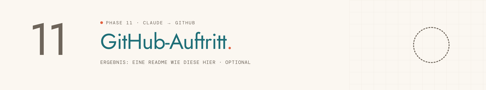
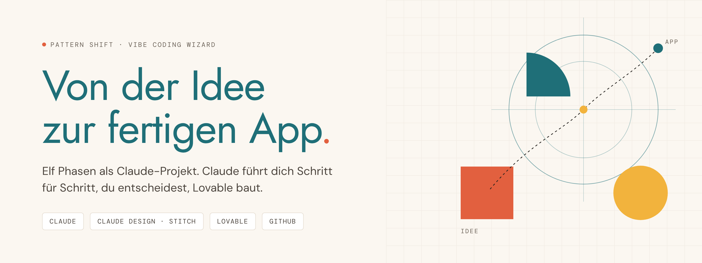

<picture>
  <source media="(prefers-color-scheme: dark)" srcset="../../assets/img/phase-11-dark.png">
  
</picture>

<p align="center"><sub><a href="10-code-auf-github.md">← 10 Code auf GitHub</a> · <a href="../../README.md#alle-phasen-im-detail">Übersicht</a></sub></p>

## Darum geht es

Dein Repository bekommt eine Startseite wie die besten Projekte auf GitHub, in den Farben deiner App.

> [!NOTE]
> Diese Phase ist optional.

## Startsatz

> [!IMPORTANT]
> **Neuer Chat für diese Phase.** Öffne im Projekt einen neuen Chat und sende dort den Startsatz. Nie im Chat der vorherigen Phase weitermachen.


```
Phase 11: GitHub-Auftritt
```

## Das brauchst du

- Dein Repo aus Phase 10
- Zwei, drei Screenshots deiner App mit Beispieldaten

## So läuft es

| # | Schritt | Was passiert |
|---|---|---|
| 1 | **Bestand** | Übergaben und Repo prüfen. |
| 2 | **Aufbau** | Gliederung der README, `docs/` und `assets/`. |
| 3 | **Banner und Grafiken** | Zwei Banner-Varianten zur Wahl, Diagramme für User Flow, Sitemap und Architektur. |
| 4 | **README-Entwurf** | Komplette Vorschau, so wie GitHub sie zeigt. |
| 5 | **Docs** | Fehlende Unterlagen ergänzen und verlinken. |
| 6 | **Veröffentlichen** | Ein Commit nach deiner Freigabe, dazu About-Box und Social Preview. |

## Das kommt raus

Das Ergebnis ist eine Startseite wie die dieses Repositorys:

<picture>
  <source media="(prefers-color-scheme: dark)" srcset="../../assets/img/banner-dark.png">
  
</picture>

| Ergebnis | Inhalt | Wofür |
|---|---|---|
| **README.md** | Banner, Badges, Screenshots, Features, Diagramme, Design System, Roadmap | Startseite deines Repos |
| **assets/ und docs/** | Grafiken, Screenshots und die Dokumentation aller Phasen | im Repo |

## Dein Teil

- [ ] About-Box ausfüllen und das Banner als Social Preview hochladen.

## Tipps

> [!TIP]
> Diese Seite hier ist mit demselben Ablauf entstanden.

> [!TIP]
> Alle Inhalte stammen aus deinen Übergaben, ohne erfundene Zahlen.

---

<sub>Der vollständige Phasen-Prompt: [`Phase 11 - GitHub-Auftritt.md`](../../projekt-dateien/Phase%2011%20-%20GitHub-Auftritt.md) · [← 10 Code auf GitHub](10-code-auf-github.md) · [Übersicht](../../README.md#alle-phasen-im-detail)</sub>
